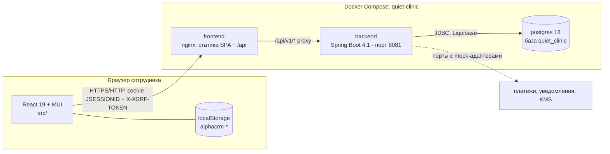
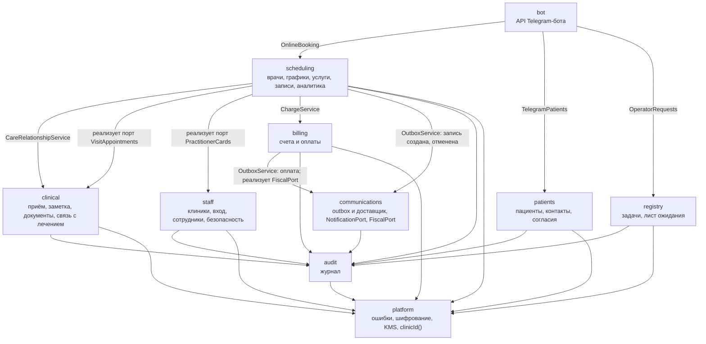
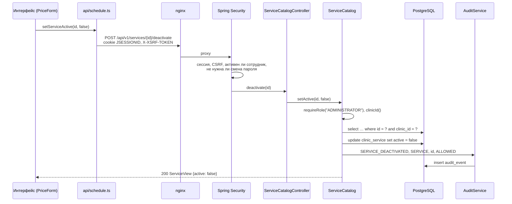
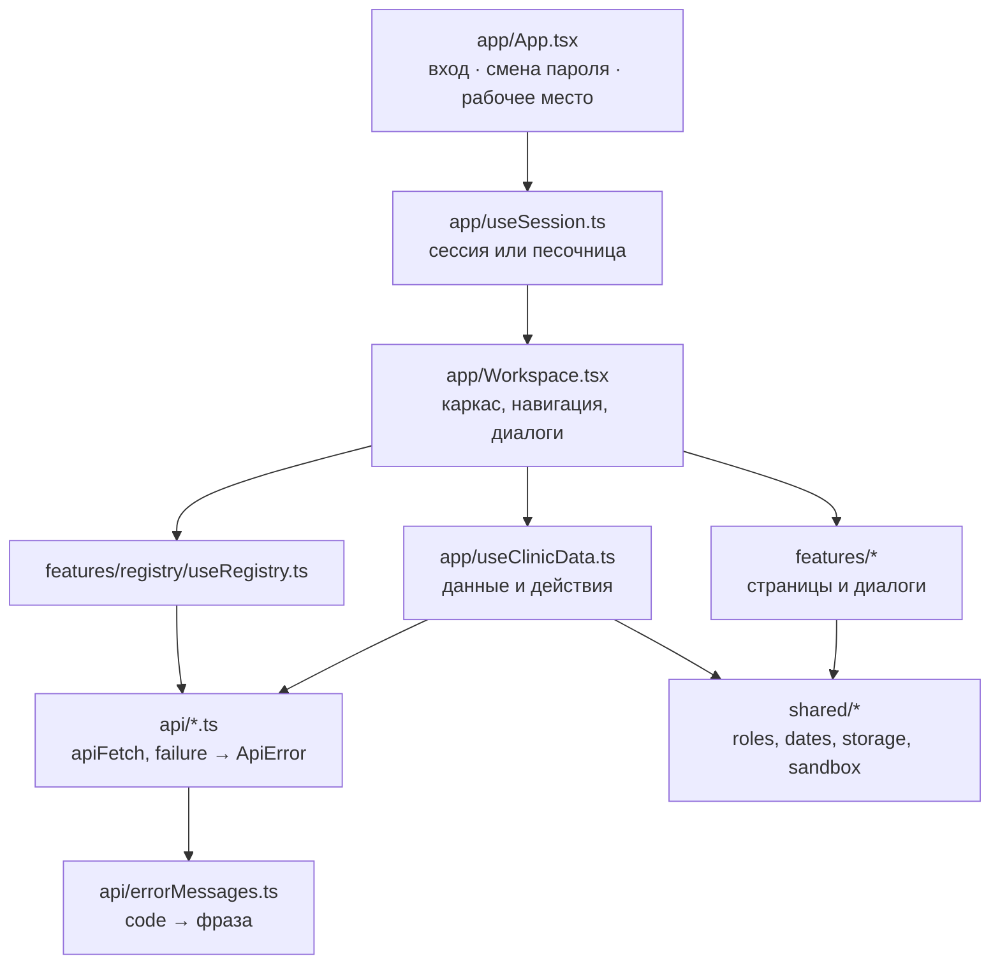
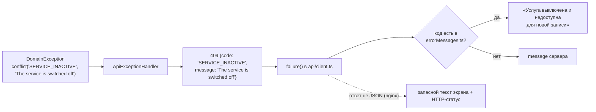

# Архитектура AlphaCRM

Документ описывает, из чего состоит проект, как части связаны между собой и по каким правилам писать код. Как устроена база — в [data-model.md](data-model.md); как запустить и какие есть маршруты API — в [README](../README.md).

## Содержание

- [Общая схема](#общая-схема)
- [Развёртывание](#развёртывание)
- [Backend: модули](#backend-модули)
- [Как проходит запрос](#как-проходит-запрос)
- [Безопасность](#безопасность)
- [Frontend](#frontend)
- [Ошибки: код и фраза](#ошибки-код-и-фраза)
- [Язык в коде](#язык-в-коде)
- [Демо-песочница](#демо-песочница)
- [Тесты](#тесты)
- [Как добавить функцию](#как-добавить-функцию)

## Общая схема

AlphaCRM — внутренняя система одной или нескольких амбулаторных клиник. Три процесса: браузер с интерфейсом, backend и PostgreSQL. Наружу смотрит только nginx.

- Интерфейс и API работают на одном origin: nginx в Docker, прокси Vite при разработке. Поэтому cookie сессии и CSRF работают без CORS.
- backend не публикует порт наружу, база слушает только `127.0.0.1`.
- Внешние системы (платёжный шлюз, SMS/email, KMS) закрыты портами; сейчас за ними безопасные mock-адаптеры, которые ничего не отправляют.

## Развёртывание

| Компонент | Образ / файл | Что внутри |
|---|---|---|
| `postgres` | `postgres:18-alpine` | том `quiet-clinic-postgres`, healthcheck `pg_isready` |
| `backend` | `deploy/backend.Dockerfile` | сборка Maven → слоёный образ на JRE 21, профиль `prod`, лимит памяти 768 МБ |
| `frontend` | `deploy/frontend.Dockerfile` | `vite build` → `nginx-unprivileged`; `deploy/nginx.conf` (прокси `/api`, SPA-fallback, кэш, `/healthz`), `deploy/security-headers.conf` (CSP и др.) |
| запуск | `scripts/start.sh`, `scripts/start.ps1` | создают `.env` со случайными секретами (`scripts/init-env.sh`) и поднимают стек |

Профили backend:

| Профиль | База | Начальный вход | Особенности |
|---|---|---|---|
| `local` | H2 в памяти | `admin` / `admin`, без смены пароля | для разработки и тестов |
| `prod` | PostgreSQL | `admin` / `CLINIC_ADMIN_PASSWORD` | `ProductionReadinessCheck` не даёт стартовать со слабым паролем администратора (короче 12 символов или `admin`) |

## Backend: модули

Spring Boot 4.1 + Spring Modulith. Корневой пакет `ru.quietclinic` (внутреннее имя не меняется), каждый подпакет — модуль. Границы проверяет `ModularityTest` (`ApplicationModules.verify()`): модуль может обращаться только к публичным типам другого модуля, циклов нет.

| Модуль | Отвечает за | Зависит от кода |
|---|---|---|
| `platform` | `DomainException` и `ApiExceptionHandler` (единый формат ошибок), `PlatformConfig` (`actorId()`, `clinicId()`, `requireRole`, фабрики ошибок), `EncryptionService`/`AesGcmEncryptionService`, `KmsPort`/`DevKmsAdapter`, `CorrelationIdFilter`, `ProductionReadinessCheck`, интерфейс `ClinicMember` | — |
| `audit` | `AuditService.record(...)`, `GET /audit` | platform |
| `staff` | клиники, учётные записи, вход/выход/смена пароля, `SecurityConfig`, CSRF, `ActiveStaffFilter`, `ClinicBootstrap` (первый администратор); порт `PractitionerCards` — новая карточка врача вместе с учётной записью | platform, audit |
| `patients` | карточка, контакты (телефон, второй телефон, e-mail, Telegram), постоянный администратор, согласия, поля регистратуры, поиск дублей телефона | platform, audit |
| `scheduling` | врачи (карточка, кабинет) и графики, справочник услуг (`ServiceCatalog`), записи и статусы, аналитика | platform, audit, clinical, billing, communications, staff |
| `registry` | задачи регистратуры (свободный текст, пациент по желанию), лист ожидания | platform, audit |
| `clinical` | приём (`Encounter`), заметка, документы и подпись, дополнения, архив подписанных, связь с лечением, PDF пациента (`PatientFile`: шифрованное хранение, подпись, выгрузка) | platform, audit |
| `billing` | счёт на завершённый приём, оплата с ключом идемпотентности, `PaymentGateway` (mock, `MOCK_NO_PROVIDER`), `CashboxFiscalAdapter` — реализация `FiscalPort` | platform, audit, communications |
| `bot` | API Telegram-бота `/api/v1/bot/**`: своя цепочка Spring Security со входом по токену `X-Bot-Token` и сервисной учётной записью с ролью `BOT` (автор в аудите — клиника); сам ничего не хранит | scheduling (`OnlineBooking`), patients (`TelegramPatients`), registry (`OperatorRequests`), platform |
| `communications` | `OutboxService` (постановка по событию), `OutboxDispatcher` (доставка, повторы, переносы), `NotificationPort` → вебхук клиники, Telegram или mock, порт кассы `FiscalPort`, экран `GET /outbox` | platform, audit |

Правила, на которых держатся границы:

- **Клинический контур не зависит от расписания.** Данные записи и перевод её в `IN_PROGRESS` он получает через свой порт `clinical.VisitAppointments`; реализация — `scheduling.ClinicalAppointmentsAdapter`. `clinical` и `billing` не импортируют `scheduling`.
- **«Сотрудники» не зависят от расписания.** Новую карточку врача `staff` создаёт через свой порт `staff.PractitionerCards` внутри транзакции создания сотрудника; реализация — `scheduling.StaffPractitionerCardsAdapter`.
- **`staff` и `registry` не импортируют другие предметные модули.** Существование пациента, врача, сотрудника или услуги они проверяют запросом к таблице через `JdbcTemplate` (`select count(*) … where id = ? and clinic_id = ?`).
- **Наружу — только через outbox.** Расписание сообщает о создании и отмене записи, касса — об оплате; что и куда отправить, решает `communications`. Запись, пациента, врача и клинику доставщик читает запросами к таблицам (`NoticeSource`) — без зависимости от их кода и без доступа к заметкам и документам. Регистратура и клинический контур наружу ничего не отправляют.

### Слои внутри модуля

Один тип — один файл. В каждом модуле:

| Слой | Пример | Правило |
|---|---|---|
| сущность и репозиторий | `ClinicService`, `ClinicServiceRepository` | поля package-private, конструктор задаёт инвариант; выборки — с `clinicId` |
| запрос и ответ API | `CreateServiceRequest`, `ServiceView` | `record`, Bean Validation на входе; ответ не отдаёт хеши, шифртексты и лишние поля |
| сервис и политика | `ServiceCatalog`, `AppointmentStatusPolicy`, `WorkingHoursPolicy` | вся логика и проверка прав (`requireRole`), запись в аудит, `@Transactional` |
| контроллер | `ServiceCatalogController` | только HTTP: путь, статус ответа, `@Valid`; логики нет |

## Как проходит запрос

Пример — администратор выключает услугу.

Ошибка на любом шаге превращается в `ApiError {timestamp, status, code, message}`: чужая клиника — `404 SERVICE_NOT_FOUND`, не та роль — `403 ACCESS_DENIED`, нет сессии — `401 UNAUTHORIZED`, нет CSRF — `403 CSRF_INVALID`.

## Безопасность

- **Вход** — `POST /api/v1/auth/login`, логин и пароль из `staff_user` (bcrypt). Неверный логин и неверный пароль дают одинаковый `401 INVALID_CREDENTIALS`. Серия неудач закрывает вход с адреса на 15 минут (`LoginThrottle`, `429 TOO_MANY_LOGIN_ATTEMPTS`). Внешнего OIDC/Keycloak нет.
- **Время** — `platform.ClinicTime`: пояс клиники (`CLINIC_TIME_ZONE`) для дней, смен и экрана, моменты в базе — UTC; запись в прошлое отклоняется (`409 APPOINTMENT_IN_PAST`). Интерфейс берёт пояс из `/auth/me` (`shared/clinicTime.ts`).
- **Сессия** — cookie `JSESSIONID`, `HttpOnly`, `SameSite=Lax`, 8 часов, `Secure` при `SESSION_COOKIE_SECURE=true`. Хранится в памяти backend.
- **CSRF** — `CookieCsrfTokenRepository`: сервер кладёт `XSRF-TOKEN`, интерфейс отправляет его в `X-XSRF-TOKEN` на изменяющих запросах (`src/api/client.ts`).
- **Роль и автор действия** сервер берёт только из сессии. Права проверяются в сервисах (`requireRole`), а не в интерфейсе: интерфейс лишь прячет недоступные кнопки.
- **Клиника** — `PlatformConfig.clinicId()` из сессии; каждая выборка ограничена ею. Строки чужой клиники выглядят как несуществующие.
- **Временный пароль** — пока сотрудник его не сменил, `ActiveStaffFilter` отвечает `403 PASSWORD_CHANGE_REQUIRED` на всё, кроме `/auth/me`, `/auth/password`, `/auth/logout`.
- **Клинический текст** — только врачу с активной связью с лечением; хранится зашифрованным (AES-256-GCM, ключ через `KmsPort`); подписанный документ неизменяем (доменный инвариант + trigger PostgreSQL).
- **Журнал аудита** пишет факты без содержимого. Подробно — [data-model.md](data-model.md#журнал-аудита-что-пишется-и-что-нет).

Проект не заявляет соответствие законодательству или регуляторным требованиям.

## Frontend

React 19, MUI, Vite, TypeScript, vitest + Testing Library.

| Папка | Что там |
|---|---|
| `src/app/` | `App.tsx` (вход, принудительная смена пароля или рабочее место), `useSession.ts`, `Workspace.tsx`, `Sidebar`/`Topbar` (бренд AlphaCRM, клиника, выход), `useClinicData.ts` (расписание, пациенты, врачи, услуги, касса: сервер или песочница), `demoData.ts`, `theme.tsx` |
| `src/api/` | по файлу на раздел API; `client.ts` — `apiFetch` (cookie, CSRF, 401 → вход) и `failure` (ошибка с фразой по коду); `errorMessages.ts`; `types.ts` — типы ответов |
| `src/features/<раздел>/` | страница, диалоги, чистые функции раздела (`booking.ts`, `registry.ts`, `serviceDraft.ts`) и их тесты |
| `src/shared/` | `roles.ts` (коды ролей `ADMINISTRATOR`… и их названия `roleLabels`, правила видимости страниц), `storage.ts` (ключи `localStorage`), `sandbox.ts`, `dates.ts`, `text.ts`, `ui.tsx` |
| `src/test/` | `setup.ts`, `helpers.tsx`: `renderApp`, `withAuth` (фальшивый сервер с сессией, CSRF и справочником услуг), `signIn`, `enterDemo`, `chooseRole`, `goOffline` |

Правила:

- Роль, статус, состояние согласия — машинные коды из API (`DOCTOR`, `COMPLETED`, `ACTIVE`). Надпись выбирается картой: `roleLabels`, `statusLabel`, `consentLabels`, `actionLabels`/`reasonLabel` в журнале.
- Списки, которые ведёт администратор, приходят с сервера: услуги (`GET /services?all=true`, в записи — только `active`), сотрудники, врачи. В живом режиме зашитых списков нет.
- `localStorage` — только удобства одного браузера: тема (`alphacrm-color-mode`) и день расписания (`alphacrm-schedule-date`). Чтение сначала нового ключа, затем прежнего `quiet-clinic-*`; запись — только под новым (`shared/storage.ts`, `public/theme-init.js`).

## Ошибки: код и фраза

- Backend: ошибка создаётся только через фабрики `PlatformConfig.conflict/forbidden/notFound/unauthorized(code, message)`. `code` — `UPPER_SNAKE_CASE` на английском, конкретный (`PATIENT_NOT_FOUND`, а не `NOT_FOUND`); `message` — короткое английское предложение.
- Frontend: новый код — новая строка в `src/api/errorMessages.ts`. Сырой `code` на экран не выводится никогда.

## Язык в коде

| Где | Язык |
|---|---|
| Java, TypeScript: идентификаторы, строки-коды, ключи объектов | английский |
| SQL: таблицы, колонки, индексы, ограничения | английский, `snake_case` |
| ключи конфигурации (`clinic.admin-full-name`), переменные окружения | английский |
| сообщения логов и исключений, `message` в ответе API | английский |
| комментарии к коду | можно русский |
| текст на экране | русский, только в интерфейсе (`src/`) |
| данные: ФИО, названия услуг и задач, заметки, демо-пациенты | как ввели, не переводятся |
| тесты | русский только там, где проверяется надпись на экране; названия тестов — на английском |

Русское значение по умолчанию, которое попадает в данные (ФИО первого администратора), задаётся в конфигурации (`CLINIC_ADMIN_NAME`, по умолчанию `Администратор` в `application.yml`), а не в Java.

## Демо-песочница

Если сервер недоступен, страница входа предлагает «Песочница: <роль>». Песочница работает без запросов от имени роли: данные из `app/demoData.ts` и `demoServices`, изменения живут в памяти вкладки (`shared/sandbox.ts`) до обновления страницы. В шапке висит «Демо-песочница: данные не сохраняются». Людей в песочнице нет — только учётные записи по ролям.

## Тесты

| Уровень | Где | Что |
|---|---|---|
| Java, правила | `backend/app/src/test/java/...`, `FooTest` рядом с `Foo` | `AppointmentStatusPolicyTest`, `WorkingHoursPolicyTest`, `PatientTest`, `MedicalDocumentTest`, `ClinicBootstrapTest`… — без Spring |
| Java, HTTP | там же | `*ControllerTest` на H2 с профилем `local`: вход как `admin`/`admin`, остальные сотрудники заводятся через API (`StaffSessions`), вторая клиника — `SecondClinic` |
| Java, PostgreSQL | `PostgresAppointmentIntegrationTest` | exclusion constraint в настоящем PostgreSQL (Testcontainers, пропускается без Docker) |
| Java, границы | `ModularityTest` | Spring Modulith |
| TS, функции | `src/**/<имя>.test.ts` | `booking.test.ts`, `storage.test.ts`, `client.test.ts`… |
| TS, сценарии | `src/features/<раздел>/<раздел>.test.tsx` | весь интерфейс с фальшивым сервером `withAuth` или песочницей |

Команды — в README, раздел «Проверки».

## Как добавить функцию

1. **Схема.** Новый changeset Liquibase (см. [data-model.md](data-model.md#миграции)), английские имена, `clinic_id`, если строку видит сотрудник.
2. **Backend.** Сущность и репозиторий с выборками по `clinicId`; `record`-запрос с валидацией; сервис с `requireRole`, записью в аудит без содержимого и ошибками с английским `code`; контроллер без логики. Если нужен другой модуль — через его публичный сервис или порт, не через его сущности.
3. **Тесты backend.** `FooTest` для правил, `*ControllerTest` для HTTP и прав ролей, чужая клиника (`SecondClinic`) должна получать `404`.
4. **Frontend.** Функция в `src/api/<раздел>.ts` через `apiFetch` и `failure`; фразы для новых кодов — в `errorMessages.ts`; подписи новых действий аудита — в `auditLabels.ts`; экран — в `src/features/<раздел>/`; поведение в песочнице — в `useClinicData` или хуке раздела.
5. **Тесты frontend.** Чистые функции — `*.test.ts`, сценарий — в `<раздел>.test.tsx`, фальшивый сервер должен отвечать как настоящий: английские `message`, те же `code`.
6. **Документация.** README (маршрут API), [data-model.md](data-model.md) (таблица), этот документ — если поменялись границы модулей.
