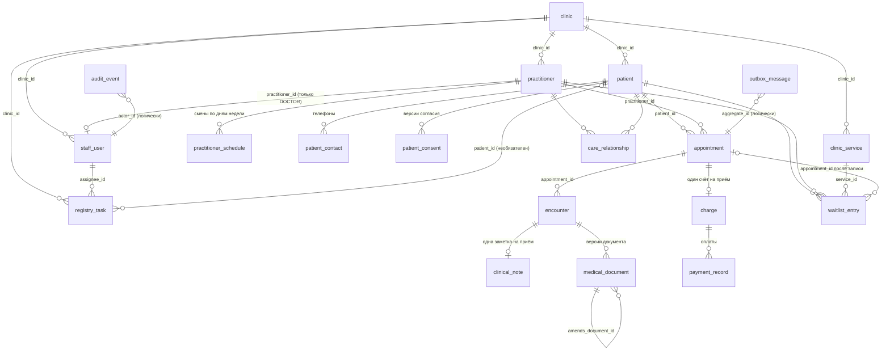

# Хранение данных: схема базы AlphaCRM

Документ описывает, где и как AlphaCRM хранит данные: таблицы, связи, ограничения, что шифруется, что попадает в журнал аудита и как схема меняется. Общая схема проекта — в [architecture.md](architecture.md).

Источник истины — миграции Liquibase в `backend/app/src/main/resources/db/changelog/` (`db.changelog-master.yaml` → `001-core.sql` … `007-services-tasks.sql`). JPA работает с `ddl-auto: validate`: Hibernate только сверяет сущности со схемой и ничего не создаёт сам. Если таблица в этом документе расходится с миграциями, правы миграции.

## Содержание

- [Где лежит база](#где-лежит-база)
- [Схема целиком](#схема-целиком)
- [Принципы хранения](#принципы-хранения)
- [Таблицы по модулям](#таблицы-по-модулям)
- [Ограничения и инварианты](#ограничения-и-инварианты)
- [Шифрование](#шифрование)
- [Журнал аудита: что пишется и что нет](#журнал-аудита-что-пишется-и-что-нет)
- [Начальные данные](#начальные-данные)
- [Миграции](#миграции)
- [PostgreSQL и H2](#postgresql-и-h2)
- [Резервные копии и перенос](#резервные-копии-и-перенос)
- [Частые вопросы](#частые-вопросы)

## Где лежит база

| Режим | СУБД | Где данные | Кто создаёт схему |
|---|---|---|---|
| Docker (`prod`) | PostgreSQL 18 | том `quiet-clinic_quiet-clinic-postgres`, база и пользователь `quiet_clinic` | Liquibase при старте backend |
| Разработка с PostgreSQL | PostgreSQL 18 в Docker | тот же том, порт `127.0.0.1:55432` | Liquibase при старте backend |
| Разработка без базы (`local`) | H2 в памяти, `MODE=PostgreSQL` | память процесса, пропадает при остановке | Liquibase при старте backend |
| Тесты backend | H2 в памяти; `PostgresAppointmentIntegrationTest` — PostgreSQL через Testcontainers | память / временный контейнер | Liquibase |

Имена `quiet_clinic` и том `quiet-clinic-postgres` остались от прежнего названия продукта и не переименовываются: на них завязана уже созданная база.

## Схема целиком

Связи «многие к одному» показаны от дочерней таблицы к родительской. `clinic` — корень: всё, что видит сотрудник, принадлежит одной клинике напрямую или через пациента и врача.

`audit_event.actor_id`, `audit_event.object_id` и `outbox_message.aggregate_id` — логические ссылки без внешнего ключа: журнал и outbox переживают любые изменения в предметных таблицах.

## Принципы хранения

1. **Идентификаторы — UUID**, их генерирует приложение (`UUID.randomUUID()`), а не база. Демо-строки миграций имеют читаемые UUID вида `00000000-0000-0000-0000-000000000101`.
2. **Время — `TIMESTAMP WITH TIME ZONE`, в UTC.** API принимает и отдаёт `2026-10-20T09:00:00Z`. Рабочие часы врача — `TIME` без зоны и считаются в UTC; дни недели — ISO (понедельник = 1).
3. **Деньги — целые копейки** (`BIGINT *_minor`) и код валюты (`VARCHAR(3)`, сейчас только `RUB`). Ни `DECIMAL`, ни `float` для денег не используются.
4. **Клиника на каждой строке, которую видит сотрудник.** Прямо — `staff_user`, `practitioner`, `patient`, `clinic_service`, `registry_task`. Через родителя — запись (через врача), приём и документы (через запись), счёт (через запись), контакты и согласия (через пациента). Сессия знает клинику сотрудника (`PlatformConfig.clinicId()`), и каждая выборка ограничена ею. Строку чужой клиники API отдаёт как несуществующую (`404`).
5. **Снимки, а не ссылки, там, где важна история.** Запись хранит название услуги и цену на момент записи (`appointment.service_name`, `amount_minor`, `currency`), подписанный документ — снимок текста (`medical_document.snapshot_encrypted`). Смена цены, выключение услуги или правка заметки не переписывают прошлое.
6. **Не удалять, а выключать или закрывать.** Сотрудник — `active = false`, услуга — `active = false`, согласие — `revoked_at`, задача — `status = 'DONE'`, ожидание — `CANCELLED`. Физическое удаление есть только в миграции 016 для прежних демо-логинов.
7. **Статусы и коды — английские машинные значения** (`BOOKED`, `SIGNED_LOCKED`, `ADMINISTRATOR`, `with-patient`) с `CHECK`-ограничениями, где набор закрыт. Русские надписи живут только в интерфейсе. Русский текст в базе — это данные: ФИО, названия услуг и задач, заметки, которые ввёл сотрудник.
8. **Оптимистичная блокировка** — колонка `version` у `appointment`, `clinical_note`, `medical_document` (`@Version` в JPA): одновременная правка одной строки даёт конфликт, а не тихую потерю данных.

## Таблицы по модулям

Обозначения: **PK** — первичный ключ, **FK** — внешний ключ, **NN** — `NOT NULL`, **U** — уникальность.

### staff — клиники и сотрудники

#### `clinic`

| Колонка | Тип | | Смысл |
|---|---|---|---|
| `id` | UUID | PK | клиника |
| `name` | VARCHAR(255) | NN | название; первая клиника получает его из `CLINIC_NAME` (по умолчанию `AlphaCRM`) при первом старте |
| `created_at` | TIMESTAMPTZ | NN | |

Первая клиника `…c001` создаётся миграцией 017; к ней привязаны все строки, существовавшие до появления клиник. Вторая клиника добавляется строкой в эту таблицу и своим администратором в `staff_user` — без правки кода.

#### `staff_user` — учётные записи

| Колонка | Тип | | Смысл |
|---|---|---|---|
| `id` | UUID | PK | у врача совпадает с `practitioner_id` (так журнал и связь с лечением показывают того же человека) |
| `clinic_id` | UUID | FK → `clinic`, NN | |
| `full_name` | VARCHAR(255) | NN | ФИО — данные, как ввёл администратор |
| `username` | VARCHAR(80) | NN, U | логин, уникален во всей установке, хранится в нижнем регистре |
| `password_hash` | VARCHAR(100) | NN | bcrypt со своей солью. Пароля в открытом виде нет нигде |
| `role` | VARCHAR(40) | NN, CHECK | `ADMINISTRATOR`, `DOCTOR`, `MANAGER`, `CASHIER` |
| `practitioner_id` | UUID | FK → `practitioner`, U | только у `DOCTOR`, у остальных `NULL` (CHECK) |
| `active` | BOOLEAN | NN | `false` — войти нельзя, открытые сессии перестают действовать |
| `must_change_password` | BOOLEAN | NN, default `false` | временный пароль: до смены API отвечает `403 PASSWORD_CHANGE_REQUIRED` |
| `created_at` | TIMESTAMPTZ | NN | |

Сессии хранятся в памяти backend (Spring Session не используется): перезапуск backend завершает все сессии.

### patients — пациенты

#### `patient`

| Колонка | Тип | | Смысл |
|---|---|---|---|
| `id` | UUID | PK | |
| `clinic_id` | UUID | FK → `clinic`, NN | |
| `full_name` | VARCHAR(255) | NN | |
| `birth_date` | DATE | NN | |
| `referral_source` | VARCHAR(40) | CHECK | откуда пришёл: `RECOMMENDATION`, `WEBSITE`, `INSURANCE`, `DOCTOR_REFERRAL`, `OTHER` или `NULL` |
| `registry_note` | VARCHAR(1000) | | заметка регистратуры; в клинический контур и врачу не попадает |
| `created_at` | TIMESTAMPTZ | NN | |

#### `patient_contact`

| Колонка | Тип | | Смысл |
|---|---|---|---|
| `id` | UUID | PK | |
| `patient_id` | UUID | FK → `patient`, NN | |
| `type` | VARCHAR(40) | NN | сейчас `PHONE` |
| `contact_value` | VARCHAR(255) | NN | как ввели; сравнение дублей идёт по цифрам (`PhoneIndex`: `8…` = `+7…`), отдельной нормализованной колонки нет |

#### `patient_consent` — версии согласия

| Колонка | Тип | | Смысл |
|---|---|---|---|
| `id` | UUID | PK | |
| `patient_id` | UUID | FK → `patient`, NN | |
| `version` | VARCHAR(80) | NN | версия формы, например `v1.2` |
| `basis` | VARCHAR(120) | NN | основание, например `SIGNED_FORM` |
| `granted_at` | TIMESTAMPTZ | NN | |
| `revoked_at` | TIMESTAMPTZ | | отзыв; строка не удаляется |

Согласие «действует», если у пациента есть строка с `revoked_at IS NULL`.

### scheduling — врачи, услуги, записи

#### `practitioner`

| Колонка | Тип | | Смысл |
|---|---|---|---|
| `id` | UUID | PK | |
| `clinic_id` | UUID | FK → `clinic`, NN | |
| `full_name` | VARCHAR(255) | NN | |
| `specialty` | VARCHAR(120) | NN | |

#### `practitioner_schedule` — недельный график

| Колонка | Тип | | Смысл |
|---|---|---|---|
| `id` | UUID | PK | |
| `practitioner_id` | UUID | FK → `practitioner`, NN | |
| `day_of_week` | SMALLINT | NN | ISO, 1 = понедельник |
| `starts_at`, `ends_at` | TIME | NN | смена в UTC |

Дня нет в таблице — у врача выходной. `PUT …/working-hours` заменяет недельный график целиком.

#### `clinic_service` — справочник услуг

| Колонка | Тип | | Смысл |
|---|---|---|---|
| `id` | UUID | PK | |
| `clinic_id` | UUID | FK → `clinic`, NN | услуги своей клиники |
| `name` | VARCHAR(255) | NN | название — данные, как ввёл администратор. В PostgreSQL уникально внутри клиники (`clinic_service_clinic_name_unique`), в H2 — во всей базе |
| `duration_minutes` | INTEGER | NN, CHECK > 0 | API принимает 1–720 |
| `price_minor` | BIGINT | NN, CHECK ≥ 0 | цена в копейках |
| `currency` | VARCHAR(3) | NN | `RUB` |
| `active` | BOOLEAN | NN, default `true` | `false` — не предлагается в новой записи и листе ожидания; строка остаётся |

Цена и выключение действуют только на новые записи. Запись не ссылается на услугу по id — она хранит снимок.

#### `appointment` — запись на приём

| Колонка | Тип | | Смысл |
|---|---|---|---|
| `id` | UUID | PK | |
| `patient_id` | UUID | FK → `patient`, NN | |
| `practitioner_id` | UUID | FK → `practitioner`, NN | клиника записи — клиника врача |
| `starts_at`, `ends_at` | TIMESTAMPTZ | NN, CHECK `ends_at > starts_at` | |
| `service_name` | VARCHAR(255) | NN | **снимок** названия услуги на момент записи |
| `amount_minor` | BIGINT | | **снимок** цены; `NULL` у записей, сделанных до появления цен |
| `currency` | VARCHAR(3) | | снимок валюты |
| `status` | VARCHAR(40) | NN | `BOOKED`, `CONFIRMED`, `ARRIVED`, `IN_PROGRESS`, `COMPLETED`, `NO_SHOW`, `CANCELLED` |
| `created_at` | TIMESTAMPTZ | NN | |
| `version` | BIGINT | NN | оптимистичная блокировка |

Индекс `appointment_practitioner_time_idx (practitioner_id, starts_at, ends_at)`. В PostgreSQL дополнительно действует exclusion constraint против пересечений (см. ниже).

### registry — регистратура

#### `registry_task` — задачи сотрудникам

| Колонка | Тип | | Смысл |
|---|---|---|---|
| `id` | UUID | PK | |
| `clinic_id` | UUID | FK → `clinic`, NN | задача без пациента тоже принадлежит клинике |
| `title` | VARCHAR(200) | NN | свободный текст администратора. Задачи до миграции 021 получили название из прежнего вида: `CALL_BACK` → «Перезвонить», `UPDATE_CONSENT` → «Обновить согласие» |
| `patient_id` | UUID | FK → `patient` | необязателен; задача без пациента видна в списке на сегодня, но не в карточке |
| `due_date` | DATE | NN | срок |
| `assignee_id` | UUID | FK → `staff_user`, NN | исполнитель |
| `status` | VARCHAR(20) | NN, CHECK | `OPEN`, `DONE` |
| `created_by` | UUID | NN | кто создал (логическая ссылка) |
| `created_at` | TIMESTAMPTZ | NN | |
| `done_at` | TIMESTAMPTZ | | когда закрыта |

Индексы: `registry_task_clinic_idx (clinic_id, status, due_date)` — список «на сегодня»; `registry_task_patient_idx (patient_id)` — карточка. Колонки `kind` больше нет (миграция 021). Задача — внутреннее напоминание: пациенту ничего не отправляется, в `outbox_message` она не попадает.

#### `waitlist_entry` — лист ожидания

| Колонка | Тип | | Смысл |
|---|---|---|---|
| `id` | UUID | PK | |
| `patient_id` | UUID | FK → `patient`, NN | |
| `practitioner_id` | UUID | FK → `practitioner`, NN | |
| `service_id` | UUID | FK → `clinic_service`, NN | новая строка — только с включённой услугой своей клиники |
| `wish_from`, `wish_to` | DATE | NN, CHECK `wish_to ≥ wish_from` | желаемый период |
| `status` | VARCHAR(20) | NN, CHECK | `ACTIVE`, `BOOKED`, `CANCELLED` |
| `appointment_id` | UUID | FK → `appointment` | запись, которой закрыто ожидание |
| `created_at` | TIMESTAMPTZ | NN | |

Индекс `waitlist_active_idx (status, practitioner_id, wish_from, wish_to)` — подбор ожидающих под свободный слот.

### clinical — клинический контур

Доступ к текстам — только врачу с активной связью с лечением. Ни один другой модуль эти таблицы не читает.

#### `care_relationship` — связь с лечением

| Колонка | Тип | | Смысл |
|---|---|---|---|
| `id` | UUID | PK | |
| `practitioner_id` | UUID | FK → `practitioner`, NN | |
| `patient_id` | UUID | FK → `patient`, NN | |
| `valid_from`, `valid_until` | TIMESTAMPTZ | NN | активна, пока `valid_until` в будущем |
| `reason` | VARCHAR(255) | NN | машинный код основания: `appointment-booking` — создана записью на приём (миграция 022 привела к нему старые русские значения) |

Создаётся автоматически при записи пациента к врачу и при переносе к другому врачу — на год.

#### `encounter` — приём

| Колонка | Тип | | Смысл |
|---|---|---|---|
| `id` | UUID | PK | |
| `appointment_id` | UUID | FK → `appointment`, NN | повторный старт той же записи возвращает тот же приём |
| `patient_id`, `practitioner_id` | UUID | FK, NN | копия из записи на момент старта |
| `status` | VARCHAR(40) | NN | `IN_PROGRESS` |
| `started_at` | TIMESTAMPTZ | NN | |
| `completed_at` | TIMESTAMPTZ | | |

#### `clinical_note` — черновик заметки приёма

| Колонка | Тип | | Смысл |
|---|---|---|---|
| `id` | UUID | PK | |
| `encounter_id` | UUID | FK → `encounter`, NN, U | одна заметка на приём |
| `complaints_encrypted` | VARCHAR(16000) | NN | **шифр** жалоб |
| `mental_status_encrypted` | VARCHAR(16000) | NN | **шифр** психического статуса |
| `diagnosis_encrypted` | VARCHAR(16000) | NN | **шифр** диагноза |
| `recommendations_encrypted` | VARCHAR(16000) | NN | **шифр** рекомендаций |
| `author_id` | UUID | NN | врач |
| `updated_at` | TIMESTAMPTZ | NN | |
| `version` | BIGINT | NN | оптимистичная блокировка |

#### `medical_document` — версии документа приёма

| Колонка | Тип | | Смысл |
|---|---|---|---|
| `id` | UUID | PK | |
| `encounter_id` | UUID | FK → `encounter`, NN | |
| `amends_document_id` | UUID | FK → `medical_document` | дополнение ссылается на исходный документ |
| `state` | VARCHAR(40) | NN | `DRAFT` → `SIGNED_LOCKED` |
| `template_version` | VARCHAR(80) | NN | версия шаблона, например `v2.4` |
| `snapshot_encrypted` | VARCHAR(32000) | NN | **шифр** снимка заметки (JSON из четырёх полей) на момент подписи |
| `content_hash` | VARCHAR(64) | | SHA-256 снимка, ставится при подписи |
| `signed_by` | UUID | | врач, подписавший документ |
| `signed_at` | TIMESTAMPTZ | | |
| `created_at` | TIMESTAMPTZ | | порядок версий (оригинал → дополнения) |
| `version` | BIGINT | NN | оптимистичная блокировка |

Индекс `medical_document_signed_idx (state, signed_by, signed_at)` — архив подписанных документов. Архив читает текст из `snapshot_encrypted`, а не из текущей заметки.

### billing — касса

#### `charge` — счёт

| Колонка | Тип | | Смысл |
|---|---|---|---|
| `id` | UUID | PK | |
| `appointment_id` | UUID | FK → `appointment`, NN, U (`charge_appointment_unique`) | один счёт на приём |
| `amount_minor` | BIGINT | NN | из снимка цены записи |
| `currency` | VARCHAR(3) | NN | |
| `status` | VARCHAR(40) | NN | `PENDING` → `PAID` |
| `created_at` | TIMESTAMPTZ | NN | |

#### `payment_record` — оплата

| Колонка | Тип | | Смысл |
|---|---|---|---|
| `id` | UUID | PK | |
| `idempotency_key` | VARCHAR(255) | NN, U | повтор с тем же ключом не создаёт второй платёж |
| `charge_id` | UUID | FK → `charge`, NN | |
| `provider_ref` | VARCHAR(255) | NN | ссылка платёжного адаптера (сейчас — безопасный mock) |
| `payment_status` | VARCHAR(40) | NN | ответ адаптера |
| `fiscal_status` | VARCHAR(40) | NN | `QUEUED` — фискализация не выполняется, только помечается |
| `created_at` | TIMESTAMPTZ | NN | |

### communications — outbox

#### `outbox_message`

| Колонка | Тип | | Смысл |
|---|---|---|---|
| `id` | UUID | PK | |
| `topic` | VARCHAR(80) | NN | например `NOTIFICATION` |
| `aggregate_type` | VARCHAR(80) | NN | например `APPOINTMENT` |
| `aggregate_id` | UUID | NN | логическая ссылка |
| `payload` | VARCHAR(4000) | NN | нейтральный JSON без персональных и клинических данных (`{"template":"appointment-confirmed","neutral":true}`) |
| `status` | VARCHAR(40) | NN | |
| `created_at` | TIMESTAMPTZ | NN | |

Пишется в той же транзакции, что и изменение записи. Реальной отправки нет: `NotificationPort` закрыт mock-адаптером.

### audit — журнал

#### `audit_event`

| Колонка | Тип | | Смысл |
|---|---|---|---|
| `id` | UUID | PK | |
| `occurred_at` | TIMESTAMPTZ | NN | индекс `audit_occurred_idx (occurred_at DESC)` |
| `actor_id` | UUID | NN | кто: id сотрудника (у врача — id карточки врача) |
| `action` | VARCHAR(120) | NN | `APPOINTMENT_CREATED`, `SERVICE_DEACTIVATED`, `REGISTRY_TASK_CREATED`, … |
| `object_type` | VARCHAR(80) | NN | `PATIENT`, `APPOINTMENT`, `SERVICE`, `TASK`, … |
| `object_id` | UUID | NN | над чем |
| `result` | VARCHAR(40) | NN | `ALLOWED` или `DENIED` |
| `reason` | VARCHAR(255) | | короткий машинный код основания |
| `correlation_id` | VARCHAR(80) | | id запроса из `CorrelationIdFilter` |

## Ограничения и инварианты

| Что | Где проверяется |
|---|---|
| У врача нет пересекающихся активных записей | приложение (`AppointmentService.checkSlot`) + PostgreSQL `appointment_no_overlap`: `EXCLUDE USING gist (practitioner_id WITH =, tstzrange(starts_at, ends_at, '[)') WITH &&) WHERE status IN ('BOOKED','CONFIRMED','ARRIVED','IN_PROGRESS','COMPLETED')`. Неявка и отмена слот освобождают |
| Запись внутри смены врача | приложение (`WorkingHoursPolicy`) |
| Подписанный документ не меняется | доменный класс `MedicalDocument` + PostgreSQL trigger `medical_document_immutable`: для `SIGNED_LOCKED` нельзя менять `snapshot_encrypted`, `content_hash`, `signed_by`, `signed_at` |
| Один счёт на приём | уникальный индекс `charge_appointment_unique` |
| Одна оплата на ключ идемпотентности | `payment_record.idempotency_key UNIQUE` |
| Карточка врача — только у роли «Врач» и у одной учётной записи | CHECK `staff_user_practitioner_only_for_doctor` + `practitioner_id UNIQUE` |
| Название услуги не повторяется в клинике | приложение + уникальный индекс в PostgreSQL |
| Закрытые наборы значений | CHECK на `staff_user.role`, `patient.referral_source`, `registry_task.status`, `waitlist_entry.status`; положительная длительность и неотрицательная цена услуги |

## Шифрование

Клинический текст (четыре поля заметки и снимок документа) хранится только в зашифрованном виде.

- Алгоритм — AES-256-GCM, случайный 96-битный nonce на каждое значение, 128-битный тег (`AesGcmEncryptionService`).
- Формат значения в колонке: `<версия ключа>.<base64url(nonce ‖ шифртекст)>`, например `dev-v1.AbC…`. Версия ключа позволит позже перешифровать данные новым ключом.
- Ключ даёт порт `KmsPort`. Сейчас это `DevKmsAdapter`: SHA-256 от `CLINIC_DEV_KMS_KEY` (в Docker — `CLINIC_KMS_KEY` из `.env`). Для промышленной эксплуатации порт заменяется адаптером настоящего KMS без изменения таблиц.
- **Потеря или смена ключа делает клинические тексты нечитаемыми.** Ключ хранится вместе с резервной копией базы, но отдельно от неё.
- Не шифруются: ФИО, телефоны, даты рождения, расписание, суммы, заметка регистратуры, названия задач. Их защищают доступ по ролям, ограничение клиникой и то, что база слушает только localhost.

## Журнал аудита: что пишется и что нет

Журнал отвечает на вопросы «кто, когда, что сделал или пытался сделать, над каким объектом». Он не хранит содержимое.

Пишется: действие, объект, результат (`ALLOWED`/`DENIED`), короткий код основания. Примеры кодов: `search`, `card`, `fullName,phone` (имена изменённых полей), `BOOKED->CONFIRMED`, `2026-10-20T09:00Z>2026-10-22T10:30Z`, `days:1,4`, `role:CASHIER`, `with-patient` / `without-patient` (задача с пациентом или без), `self`.

Не пишется никогда: клинический текст, текст документа, значения полей пациента, телефоны, ФИО, текст задачи регистратуры, заметка регистратуры, пароли и хеши. Русскую подпись к коду выбирает интерфейс (`src/features/audit/auditLabels.ts`).

## Начальные данные

Миграции кладут синтетические демо-данные — ни одного реального человека:

| Что | Миграция | Замечание |
|---|---|---|
| Пациенты Анна Михайлова, Дмитрий Волков, Мария Соколова и их согласия | 001 | данные, имена не переводятся |
| Врачи Александр Петров и Ольга Лебедева, их графики | 001, 003 | без учётных записей: войти под ними нельзя |
| Услуги «Первичный приём» (50 мин, 4 500 ₽) и «Повторный приём» (30 мин, 3 000 ₽) | 004 | начальный справочник; администратор может выключить их и завести свои |
| Синтетическая история приёмов за октябрь 2026 | 003 | для экрана аналитики |
| Первая клиника `…c001` | 017 | название при первом старте берётся из `CLINIC_NAME` |

Сотрудников миграции не создают. Если `staff_user` пуст, при старте `ClinicBootstrap` создаёт администратора `admin` с паролем из `CLINIC_ADMIN_PASSWORD` (ФИО — `CLINIC_ADMIN_NAME`) и переименовывает первую клинику в `CLINIC_NAME`. Хеш пароля считается при старте; ни пароля, ни хеша нет ни в коде, ни в миграциях.

## Миграции

Все changeset-ы — `quietclinic:<номер>`, формат Liquibase formatted SQL. **Применённые changeset-ы не переписываются**: Liquibase сверяет контрольные суммы и не стартует при расхождении. Любое изменение схемы или данных — новый changeset в конце.

| Файл | Changeset | Что делает |
|---|---|---|
| `001-core.sql` | 001 | базовые таблицы: пациенты, врачи, записи, клинический контур, касса, outbox, аудит; демо-данные |
| `002-postgresql-invariants.sql` | 002, 003 (PostgreSQL) | exclusion constraint против пересечений; trigger неизменяемости подписанного документа |
| `003-crm-features.sql` | 004–006 | второй врач и графики; история приёмов для аналитики; `COMPLETED` в exclusion constraint |
| `004-visits-billing.sql` | 007–012 | справочник услуг; снимок цены в записи; один счёт на приём; связи с лечением для старых записей; `medical_document.created_at` |
| `005-staff-registry.sql` | 013–015 | `staff_user`; поля регистратуры у пациента; `registry_task`, `waitlist_entry` |
| `006-clinics.sql` | 016–018 | удаление прежних демо-логинов; `clinic` и `clinic_id`; `must_change_password`; индекс архива документов |
| `007-services-tasks.sql` | 019 | `clinic_service.clinic_id`, `active` |
| | 020 (PostgreSQL) | уникальность названия услуги внутри клиники вместо глобальной |
| | 021 | задача регистратуры: `title` вместо `kind`, `clinic_id`, необязательный `patient_id`; старые виды стали названиями |
| | 022 | основание связи с лечением — машинный код `appointment-booking` |

Как добавить изменение:

1. Новый changeset в конце последнего файла или новый файл `008-….sql`, подключённый в `db.changelog-master.yaml`.
2. Идентификаторы таблиц, колонок, индексов и ограничений — на английском, `snake_case`. Русский допустим только в значениях данных и в комментариях `--`.
3. Если колонка становится `NOT NULL`, сначала добавьте её nullable, заполните `UPDATE`, затем `SET NOT NULL` — так миграция пройдёт на базе с данными.
4. Разницу PostgreSQL/H2 оформляйте отдельными changeset-ами с `dbms:postgresql` / `dbms:h2`.
5. Обновите JPA-сущность: `ddl-auto: validate` не даст запуститься при расхождении.
6. Обновите этот документ.

## PostgreSQL и H2

| Возможность | PostgreSQL | H2 (`local`, тесты) |
|---|---|---|
| Запрет пересечений записей | exclusion constraint + приложение | только приложение |
| Неизменяемость подписанного документа | trigger + доменный класс | только доменный класс |
| Уникальность названия услуги | внутри клиники | во всей базе (безымянное ограничение из 007 переносимо не удаляется) |
| Связи с лечением для старых записей | changeset 011 | changeset 010 |

Поэтому проверка пересечений на настоящей базе вынесена в `PostgresAppointmentIntegrationTest` (Testcontainers).

## Резервные копии и перенос

- Копия и восстановление — `pg_dump -Fc` / `pg_restore` внутри контейнера `postgres`, команды — в README, раздел «Резервная копия базы».
- В копии клинические тексты зашифрованы; без того же `CLINIC_KMS_KEY` они не читаются. Храните ключ отдельно от копии, но так, чтобы его можно было найти при восстановлении.
- Пароль базы из `.env` применяется только при первом создании тома. Восстановление в новый том — с теми же `POSTGRES_PASSWORD` и `CLINIC_KMS_KEY`.
- `docker compose down -v` удаляет том вместе со всеми данными.

## Частые вопросы

**Почему запись хранит название услуги строкой, а не `service_id`?** Это снимок: переименование, смена цены или выключение услуги не должны менять прошлые записи, счёт и кассу.

**Как убрать услугу?** Выключить (`POST /api/v1/services/{id}/deactivate` или кнопка «Выключить» на странице «График и цены»). Строка остаётся: на неё могут ссылаться ожидания, и её можно включить снова.

**Куда делась колонка `registry_task.kind`?** Миграция 021 перенесла её значения в `title` («Перезвонить», «Обновить согласие») и удалила колонку. Задачи не потерялись.

**Где хранятся сессии?** В памяти backend. Таблицы сессий нет; перезапуск backend выводит всех сотрудников.

**Где хранится выбор темы и дня расписания?** В браузере сотрудника, `localStorage`: ключи `alphacrm-color-mode` и `alphacrm-schedule-date`. Если нового ключа ещё нет, интерфейс читает прежний `quiet-clinic-*` и дальше пишет под новым. В базу это не попадает.
