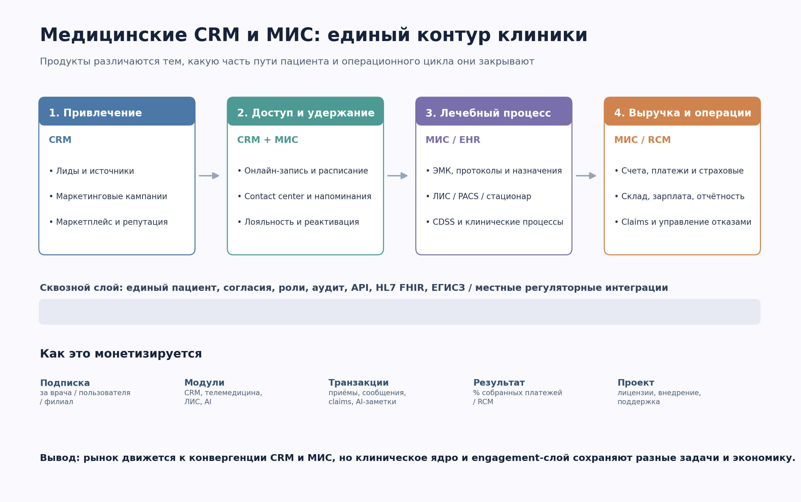

# Анализ рынка медицинских CRM и МИС

**География:** Россия/СНГ и международный рынок.  
**Фокус:** продукты, ключевые функции, модели монетизации и продуктовые возможности.  
**Дата подготовки:** 1 ноября 2026 года. Цены ниже — публичные ориентиры, а не коммерческие предложения; у большинства enterprise-вендоров итоговая стоимость рассчитывается индивидуально.

## Executive Summary

Рынок медицинских CRM и МИС нельзя корректно рассматривать как одну категорию программного обеспечения. В нём одновременно существуют четыре типа продуктов: CRM для привлечения и удержания пациентов; МИС для частных амбулаторных клиник, объединяющие расписание, ЭМК, биллинг и склад; тяжёлые клинические платформы для больниц и региональных систем; а также платформы patient engagement, которые работают поверх EHR. В малом и среднем сегменте эти категории сходятся в продукты «всё в одном»: Medesk, ArchiMed+, IDENT, Tebra и eClinicalWorks закрывают и административный, и клинический, и финансовый контуры. В enterprise-сегменте разделение сохраняется: Epic, Oracle Health или MEDITECH служат клиническим ядром, а Salesforce Health Cloud, Microsoft for Healthcare либо Epic Cheers отвечают за коммуникации, contact center, кампании и координацию помощи. Поэтому главный вопрос при сравнении — не сколько функций заявлено на сайте, а какую часть реального пути пациента система способна вести без ручного переноса данных.

Монетизация развивается от простой лицензии к смешанной экономике. Для небольших клиник типичны freemium и подписка за врача, пользователя, филиал или объём приёмов; дополнительные доходы вендор получает на SMS, телемедицине, интеграциях, платежах, AI-заметках и расширенной аналитике. В сегменте revenue cycle management применяется процент от собранных платежей: athenaOne прямо использует такую модель, а eClinicalWorks предлагает RCM как отдельный сервис. Для крупных внедрений остаются контракты на лицензии или облачную платформу, проектное внедрение, миграцию, доработки и сопровождение. Наиболее устойчивые конкурентные преимущества — не интерфейс расписания, который сравнительно легко воспроизвести, а глубина специализации, качество клинической модели данных, локальные интеграции, безопасность, партнёрская сеть и стоимость перехода с накопленной историей пациентов. Для нового продукта особенно интересны ниши CRM-надстройки над установленными МИС, вертикальных рабочих процессов, AI для регистратуры и финансового контура, а также миграции и качества данных.

## 1. Границы рынка: чем CRM отличается от МИС

Медицинская CRM управляет отношениями с человеком до, между и после визитов. Её ядро — лиды и источники обращений, история контактов, сегментация, кампании, онлайн-запись, напоминания, лояльность, репутация, работа contact center и аналитика конверсии. МИС или EHR управляет оказанием медицинской помощи и связанными операциями: электронной медицинской картой, протоколами, диагнозами, назначениями, результатами исследований, лекарственной терапией, стационаром, коечным фондом, лабораторией, врачебными рабочими местами и обязательной отчётностью. Финансовый блок встречается в обеих категориях, но с разной целью: CRM оценивает выручку от канала и удержание пациента, а МИС проводит услугу, счёт, оплату, страховой случай и складское списание. На практике название продукта ненадёжно: российские вендоры часто называют «CRM для клиники» полноценную МИС, а международные EHR включают портал и инструменты взаимодействия, которые по сути являются CRM.

| Контур | Типичные функции CRM | Типичные функции МИС / EHR | Экономическая ценность |
|---|---|---|---|
| Привлечение | Лиды, формы, call tracking, источники, кампании, маркетплейс | Обычно ограничен или отсутствует | Рост числа обращений и снижение стоимости привлечения |
| Доступ к помощи | Онлайн-запись, напоминания, мессенджеры, contact center | Расписание ресурсов, регистратура, лист ожидания, ADT | Загрузка врачей, меньше no-show и ручной работы |
| Клинический процесс | Care plans, задачи координатора, контроль выполнения программы | ЭМК, шаблоны, МКБ, назначения, eRx, ЛИС/PACS, стационар, CDSS | Качество, безопасность и скорость оказания помощи |
| Удержание | Сегментация, реактивация, лояльность, отзывы, patient journeys | Повторные назначения и планы наблюдения | LTV, возвращаемость, выполнение плана лечения |
| Финансы | ROMI, воронка, прогноз выручки | Счета, касса, ДМС/ОМС, claims, RCM, оплаты | Ускорение оплаты и снижение потерь выручки |
| Операции | Аналитика персонала contact center | Склад, аптека, зарплата, филиалы, управленческая отчётность | Контроль себестоимости и масштабирование сети |
| Данные и compliance | Согласия на коммуникации, права, аудит обращений | Роли, аудит, подписи, HL7/FHIR, ЕГИСЗ и локальная отчётность | Снижение регуляторного и операционного риска |

Наиболее сильная продуктовая архитектура строится вокруг единого идентификатора пациента и связанных событий, а не вокруг двух дублирующихся карточек в CRM и МИС. Например, обращение из рекламы должно превратиться в запись, запись — в визит, визит — в оказанные услуги и оплату, а назначенный контроль — в новую коммуникацию с учётом согласия пациента. Если эти события живут в несвязанных системах, клиника получает ручной ввод, плохую атрибуцию и невозможность надёжно посчитать конверсию, no-show, LTV или доход по каналу. Именно поэтому отдельная CRM наиболее ценна тогда, когда имеет надёжную двустороннюю интеграцию с клиническим ядром, а полноценная МИС становится конкурентоспособной только при наличии современного engagement-слоя. Технологически это сдвигает конкуренцию от набора экранов к качеству API, модели данных, очередей событий и управлению согласиями.

## 2. Россия и СНГ: основные продукты

Российский рынок удобно разделить на облачные продукты для частных клиник, профильные решения и проектные МИС для крупных медицинских организаций. В первой группе конкуренция идёт вокруг быстрого запуска, удобства регистратуры и врача, онлайн-записи, отчётности и встроенных коммуникаций. Во второй решающее значение имеет специализация: у стоматологии это зубная формула, планы лечения, снимки, материалы и зуботехническая лаборатория. В третьей — масштабирование, настройка под сложные процессы, стационар, ОМС/ДМС, лаборатория, PACS, права доступа и интеграции с государственным контуром. Тарифная прозрачность уменьшается по мере роста сложности: если Medesk и ClinicCards публикуют понятные условия, то тяжёлые платформы формируют цену после обследования и определения состава работ.

| Продукт | Тип и целевой сегмент | Ключевые функции | Модель монетизации |
|---|---|---|---|
| **Medesk** | Облачная МИС с CRM для частных клиник | Расписание, онлайн-запись, ЭМК, счета и оплаты, телемедицина, аналитика, открытый API, модуль ЕГИСЗ | Freemium: до 2 пользователей, 1 000 карт и 50 приёмов/мес.; Pro от **1 200 ₽/мес. за 50 приёмов**, без ограничения пользователей и карт. [Medesk](kimi-cite://web?url=https%3A%2F%2Fwww.medesk.ru%2F "citation") |
| **ArchiMed+** | МИС для частных клиник и сетей | Карта пациента, расписание, ЭМК, финансы, ДМС/ОМС, лаборатория, склад, IP-телефония, отчёты, филиалы | Цена зависит от рабочих мест и функционала; **разовая покупка без абонентской платы**, внедрение и настройка через вендора. [ArchiMed+](kimi-cite://web?url=http%3A%2F%2Fwww.archimed-soft.ru%2F "citation") |
| **IDENT** | Вертикальная МИС/CRM для стоматологий | Амбулаторная карта, ЕГИСЗ, планы лечения, авторентген, фотопротоколы, материалы, лаборатория, зарплата, CRM, маркетинг, Diagnocat | Модульные тарифы для клиники; точная цена рассчитывается через вендора, есть специальный пакет для новых клиник с 1–2 креслами. [IDENT](kimi-cite://web?url=https%3A%2F%2Fident24.ru%2F "citation") |
| **YCLIENTS** | CRM и платформа онлайн-записи для сферы услуг и медицины | Расписание, клиентская база, уведомления, лояльность, абонементы, финансовый и складской учёт, аналитика, интеграции и карты | Подписка по числу сотрудников и сроку лицензии; отдельные платные модули и интеграционные места. Не стоит без проверки считать полной заменой клинической МИС. [YCLIENTS](kimi-cite://web?url=https%3A%2F%2Fpartners.yclients.com%2Fself-employed%2Fsubscription "citation") |
| **ClinicCards** | Облачная стоматологическая CRM/МИС | Карточки и история лечения, расписание, планы лечения, расчёты, отчёты, зарплата, файлы и совместный доступ | Free; Pro от **$240/год за базовый пакет до 2 аккаунтов**, дополнительный участник — $120/год. [ClinicCards](kimi-cite://web?url=https%3A%2F%2Fcliniccards.com%2Fru "citation") |
| **1С:Медицина** | Семейство отраслевых решений для поликлиник, больниц и профильных клиник | Клинические и административные процессы, рабочие места, учёт, отчётность, интеграция с инфраструктурой 1С | Лицензии на конфигурацию и рабочие места, внедрение партнёром, доработки и сопровождение/ИТС. Пример публичной цены конфигурации «Поликлиника», ред. 3 — **57 200 ₽**, но это не TCO проекта. [1С](kimi-cite://web?url=https%3A%2F%2Fsolutions.1c.ru%2Fmed%2Fclinic%2Fgov%2F10 "citation") |
| **МЕДИАЛОГ** | Комплексная модульная МИС для многопрофильных организаций | ЭМК, расписание, финансы, материалы и аптека, коечный фонд, ЛИС, PACS/DICOM, оборудование, HL7, статистика | Индивидуальный проект из модулей, лицензий, внедрения, интеграций и поддержки; единый публичный тариф не применим. [МЕДИАЛОГ](kimi-cite://web?url=https%3A%2F%2Fmedsoftservice.ru%2Fhelp%2Fintro_overview.htm "citation") |
| **ИНФОКЛИНИКА** | МИС для поликлиник, больниц, центров и сетей | ЭМК, онлайн-запись, стационар, ДМС/ОМС, телемедицина, лаборатория, склад, колл-центр, финансы и филиалы | Лицензии и модули плюс внедрение; публичная стартовая цена **от 60 тыс. ₽**, итог зависит от состава работ. [ИНФОКЛИНИКА](kimi-cite://web?url=https%3A%2F%2Fsdsys.ru%2Fproducts%2Finfoclinica%2F "citation") |

Дополнительно в российском ландшафте заметны qMS, БАРС.Здравоохранение, РТ МИС, Клиентикс, МедАнгел, iClinic и другие системы. Их наличие важно для конкурентного анализа, но не все публикуют достаточно прозрачные тарифы и детали упаковки, поэтому включать непроверенные цены в сравнение было бы некорректно. Для покупателя в этом рынке особенно важно запросить не только демонстрацию интерфейса, но и сценарии передачи СЭМД, подписания документов, обновления справочников, восстановления после сбоя, экспорта полной базы и подключения конкретной лаборатории или кассы. Для нового вендора локальные требования создают высокий входной барьер: одна только красивая CRM без ЭМК, подписей, регуляторных интеграций и миграции не заменит рабочую МИС. Однако этот же барьер оставляет возможность для надстроек, которые подключаются к уже внедрённому ядру и улучшают запись, коммуникации, контроль администраторов и аналитику без рискованной замены всей системы.

## 3. Международный рынок: EHR, практика и Healthcare CRM

Международный рынок показывает те же сегменты, но сильнее выражены страховой биллинг, interoperability и patient experience. В больничном сегменте доминируют комплексные EHR-платформы с модулями для клинических отделений, revenue cycle, аналитики и обмена данными. В независимых практиках распространены облачные пакеты per provider per month, где EHR, practice management, телемедицина и пациентский портал продаются вместе. Отдельный слой образуют Healthcare CRM: Salesforce Health Cloud и Microsoft for Healthcare не обязаны заменять EHR, но связывают клинические и неклинические данные для обращений, направлений, программ помощи и контакт-центра. Epic выбрал альтернативный путь и развивает Cheers как нативную CRM внутри собственной экосистемы. Это подтверждает, что конкуренция идёт не только за медицинскую карту, но и за весь жизненный цикл взаимодействия с пациентом.

| Продукт | Тип и ключевые функции | Модель монетизации |
|---|---|---|
| **Epic + MyChart + Cheers** | Enterprise EHR, специализированные клинические модули, interoperability, портал MyChart; Cheers — кампании, care gaps, prospective patients, contact center и маршрутизация обращений | Индивидуальный enterprise-контракт, внедрение и сопровождение; Cheers — дополнительный компонент экосистемы без публичного универсального тарифа. [Epic](kimi-cite://web?url=https%3A%2F%2Fwww.epic.com%2Fsoftware%2F "citation"), [Healthcare IT Leaders](kimi-cite://web?url=https%3A%2F%2Fwww.healthcareitleaders.com%2Fblog%2Fepic-cheers-crm-solutions%2F "citation") |
| **Oracle Health** | Клинический пакет, continuum of care, interoperability, financial operations/RCM, consumer experience, population health, AI и облачная инфраструктура | Корпоративная подписка/контракт и услуги внедрения, состав определяется проектом; публичной единой цены нет. [Oracle Health](kimi-cite://web?url=https%3A%2F%2Fwww.oracle.com%2Fhealth%2F "citation") |
| **MEDITECH Expanse** | EHR для стационарной и амбулаторной помощи, Patient Connect, pharmacy, pathology, population health, revenue cycle, analytics и AI | Enterprise-контракт; вариант MEDITECH as a Service переводит поставку в управляемую облачную модель. [MEDITECH](kimi-cite://web?url=https%3A%2F%2Fwww.meditech.com%2F "citation") |
| **athenaOne** | Облачные EHR, practice management, patient engagement, телемедицина, биллинг и RCM | Официально заявлена модель **процента от собранных платежей**; конкретная ставка определяется предложением. [athenahealth](kimi-cite://web?url=https%3A%2F%2Fwww.athenahealth.com%2Fsolutions%2Fathenaone "citation") |
| **eClinicalWorks** | Амбулаторная EHR, practice management, patient engagement, телемедицина и RCM | Публичные ориентиры: EHR **$449**, EHR + PM **$599 за врача/мес.**, RCM as a Service — **2,9% сборов**. [Tebra](kimi-cite://web?url=https%3A%2F%2Fwww.tebra.com%2Ftheintake%2Fpractice-operations%2Foptimize-operations%2Femr-vs-ehr-a-guide-to-the-differences-and-when-to-use-each "citation") |
| **Tebra** | EHR, биллинг, телемедицина, scheduling, patient experience и маркетинг для независимых практик | Подписка **$49–799 за врача/мес.** в зависимости от решения, типа врача и объёма claims; не процент от выручки. AI Note Assist — $0,99/заметка или $99/мес. [Tebra](kimi-cite://web?url=https%3A%2F%2Fwww.tebra.com%2Fpricing%2Foverview "citation"), [Tebra AI](kimi-cite://web?url=https%3A%2F%2Fwww.tebra.com%2Ftheintake%2Ftebra-news%2Fmeet-tebra-ai-smart-staff "citation") |
| **DrChrono** | EHR, practice management, billing, портал, телемедицина, мобильные приложения и AI-add-ons | Тарифы Foundation/Growth/Premium через запрос предложения; лимиты сообщений и факсов, плата за превышение, claims, платежи, лаборатории и часть AI-функций. [DrChrono](kimi-cite://web?url=https%3A%2F%2Fwww.drchrono.com%2Fpricing%2F "citation") |
| **SimplePractice** | Практика для mental health и частных специалистов: записи, клиентский портал, телемедицина, заметки, биллинг | Starter **$49**, Essential **$79**, Plus **$99/мес.**; дополнительные врачи, ePrescribe и AI Note Taker оплачиваются отдельно. [SimplePractice](kimi-cite://web?url=https%3A%2F%2Fwww.simplepractice.com%2Fpricing%2F "citation") |
| **Salesforce Health Cloud** | Healthcare CRM поверх EHR: patient/member/provider 360, care plans, referrals, contact center, appointments, FHIR-aligned data model | Enterprise **$350**, Unlimited **$525**, Agentforce 1 **$750 за пользователя/мес.** при годовой оплате; внедрение и дополнительные продукты отдельно. [Salesforce](kimi-cite://web?url=https%3A%2F%2Fwww.salesforce.com%2Fau%2Fhealthcare%2Fcloud%2Fpricing%2F "citation") |
| **Microsoft for Healthcare** | Dynamics 365, Azure, Power Platform и Microsoft 365: patient engagement, contact center, virtual appointments, care management и командная работа | Модульная подписка на используемые облачные продукты плюс интеграция и внедрение; единого тарифа «всё для клиники» нет. [Microsoft Learn](kimi-cite://web?url=https%3A%2F%2Flearn.microsoft.com%2Fen-us%2Findustry%2Fhealthcare%2Foverview "citation") |
| **OpenEMR / OpenMRS** | Открытые EHR/EMR-платформы: записи, расписание, billing, e-prescribing, лаборатории, правила и настраиваемые формы | Лицензия бесплатна; выручка экосистемы формируется на хостинге, внедрении, доработке, интеграциях, обучении и поддержке. [OpenEMR](kimi-cite://web?url=https%3A%2F%2Fwww.open-emr.org%2F "citation") |

Зрелость международных продуктов проявляется в том, что пациентский портал, телемедицина и онлайн-запись уже стали базовыми ожиданиями, а не самостоятельным преимуществом. Дифференциация смещается в три области: специализированные клинические процессы, финансовый результат и автоматизация на основе данных. Например, Oracle Health описывает AI и автоматизацию не только для документации, но и для финансового цикла от регистрации до сбора оплаты, а Tebra отдельно продаёт генерацию AI-заметок по подписке или за каждую заметку. Для небольшой практики привлекательна предсказуемая цена за врача, но при росте числа специалистов она может стать значительной; процент от сборов снижает фиксированную нагрузку, зато масштабируется вместе с выручкой. Enterprise CRM ещё дороже на уровне лицензий и требует сильного интеграционного проекта, поэтому её покупают ради масштабной координации и персонализации, а не ради простой базы контактов.

## 4. Как продукты монетизируются

Вендоры редко ограничиваются одной ставкой. Типовой контракт сочетает базовый доступ, пакет модулей и переменные расходы, которые растут с использованием. Например, подписка может включать ЭМК и расписание, но ограничивать число приёмов, сообщений или claims; интеграция с лабораторией и AI-ассистент подключаются отдельно; платёжный сервис приносит комиссию с транзакции. Для вендора это создаёт expansion revenue: доход существующего клиента растёт по мере добавления врачей, филиалов, каналов коммуникации и модулей. Для клиники преимущество состоит в низком пороге входа, а риск — в непредсказуемом совокупном счёте. Поэтому сравнивать продукты нужно на одинаковом сценарии: число врачей и администраторов, филиалов, визитов, сообщений, лабораторных заказов, AI-заметок и платежей в месяц.

| Модель | За что платит клиент | Примеры | Сильная сторона для вендора | Риск для клиента |
|---|---|---|---|---|
| **Freemium** | Ноль на ограниченном объёме, затем подписка | Medesk, ClinicCards | Быстрый self-service и низкая стоимость привлечения | Ограничения становятся заметны после роста базы |
| **Per provider / user** | Число врачей или пользователей | Tebra, SimplePractice, Salesforce Health Cloud | Понятный ARR и рост вместе со штатом | Дорого при большом числе лицензий |
| **Per clinic / branch / workstation** | Организация, филиал или рабочее место | IDENT, ArchiMed+, 1С | Соответствие структуре клиники | Сложно сравнивать пакеты и границы лицензии |
| **Per encounter / usage** | Приёмы, сообщения, claims, факсы, AI-заметки | Medesk, DrChrono, Tebra | Доход растёт с реальным использованием | Счёт зависит от сезонности и объёма |
| **Модульная упаковка** | CRM, ЛИС, телемедицина, склад, AI, аналитика | IDENT, MEDITECH, 1С, МЕДИАЛОГ | Expansion revenue и гибкое предложение | Базовый тариф может не закрывать нужный процесс |
| **% от собранных платежей** | Доля фактически полученной выручки | athenaOne, RCM eClinicalWorks | Интересы вендора связаны с собираемостью | При высокой выручке модель может стать дорогой |
| **Enterprise project** | Лицензии/облако, внедрение, миграция, SLA | Epic, Oracle Health, qMS, МЕДИАЛОГ | Высокий чек и долгосрочные отношения | Долгий запуск и значительная доля услуг |
| **Open source + services** | Хостинг, настройка, доработка и поддержка | OpenEMR, OpenMRS | Нет лицензионного lock-in, услуги партнёров | Нужны компетенции и ответственность за эксплуатацию |
| **Payments / marketplace / services** | Комиссия, видимость, реклама, managed services | Tebra, Doctolib, YCLIENTS | Дополнительная монетизация поверх SaaS | Зависимость от канала и транзакционных условий |

Стоимость владения должна считаться минимум на горизонте трёх лет и включать не только лицензии. В расчёт входят обследование, настройка, перенос пациентов и документов, интеграции с лабораториями и оборудованием, телефония, касса, электронные подписи, обучение, поддержка, обновления, резервное копирование, инфраструктура и стоимость выхода. Разовая лицензия не обязательно дешевле SaaS, потому что сервер, обновления и сопровождение остаются на стороне клиента; бесплатный open-source не обязательно дешевле коммерческого облака, потому что требует технической команды. Низкая подписка может стать дороже после включения сообщений и дополнительных модулей. Наиболее полезный финансовый показатель — не «цена программы», а стоимость на завершённый визит или на врача при заданном объёме, дополненная влиянием на no-show, скорость документирования, загрузку расписания и собираемость платежей.

## 5. Ключевые функции, которые реально определяют конкурентоспособность

Базовый функциональный минимум уже широко воспроизведён: карточка пациента, календарь, онлайн-запись, напоминания, счета и стандартные отчёты есть у большинства участников. Поэтому анализ должен различать наличие функции и её глубину. Расписание может быть простым календарём или учитывать кабинеты, оборудование, повторяющиеся процедуры, филиалы, лист ожидания и правила доступности. ЭМК может быть текстовым полем или структурированной клинической моделью с шаблонами по специальности, диагнозами, назначениями, версиями, подписями и контролем качества. CRM-аналитика может показывать только источник в карточке или связывать расходы на канал с записями, состоявшимися визитами, оплатами и повторными обращениями. Именно глубина сценария определяет ценность продукта и сложность его замены конкурентом.

| Слой | Базовый минимум | Сильный продуктовый уровень |
|---|---|---|
| **Patient 360** | Контакты и история визитов | Единая идентичность, коммуникации, согласия, документы, клинические и финансовые события без дублей |
| **Запись и доступ** | Календарь и форма на сайте | Мультиресурсное расписание, ожидание, переносы, предоплата, маршрутизация, прогноз no-show |
| **Коммуникации** | SMS/email-напоминания | Омниканальные сценарии, мессенджеры, contact center, записи звонков, контроль качества и согласий |
| **ЭМК** | Протоколы и вложения | Специализированные шаблоны, структурированные назначения, МКБ, eRx, CDSS, подпись и аудит |
| **Специализация** | Общая карта для всех врачей | Зубная формула, планы лечения, психотерапия, онкология, операционные, реабилитация и профильные показатели |
| **Диагностика** | Ручная загрузка результатов | ЛИС, анализаторы, DICOM/PACS, штрих-коды, статусы заказов и автоматическая связь с ЭМК |
| **Стационар** | Список госпитализаций | ADT, коечный фонд, медсестринские процессы, операционные, лекарственное назначение и выписка |
| **Финансы** | Счёт и оплата | ДМС/ОМС или claims, eligibility, coding, denial management, RCM, сверка и пациентские платежи |
| **Управление сетью** | Несколько филиалов в одной базе | Единые справочники, разные права и финансы, межфилиальная запись, консолидированная аналитика |
| **Интеграции и безопасность** | Экспорт Excel и роли | API, webhooks, HL7/FHIR, ЕГИСЗ, SSO, детальный аудит, шифрование, резервирование и экспорт при выходе |

AI становится новым платным слоем, но его значение зависит от встраивания в рабочий процесс. Генерация черновика протокола экономит время только тогда, когда врач может быстро проверить и принять результат, а структурированные данные попадают в нужные поля ЭМК. Для регистратуры перспективны распознавание намерения звонящего, автоматическая запись, обработка переносов, ответы на типовые вопросы и контроль качества разговоров; для финансового контура — проверка документации, кодирование, приоритетные авторизации и предотвращение отказов. При этом медицинская безопасность, объяснимость, человеческое подтверждение, разграничение доступа и работа с персональными данными остаются обязательными. Поэтому побеждает не просто наличие AI-кнопки, а сочетание качественных данных, глубокой интеграции, измеримого эффекта и понятной цены за пользователя, заметку или обработанный случай.

## 6. Рыночные закономерности и перспективные ниши

Первая закономерность — конвергенция: частная клиника предпочитает одну систему вместо отдельных CRM, расписания, ЭМК и кассы, но крупная организация сохраняет модульную архитектуру. Вторая — вертикализация: универсальная карта проигрывает решению, которое из коробки понимает конкретную специальность. Третья — сдвиг от продажи доступа к продаже результата: снижение no-show, ускорение документации, рост повторных визитов и улучшение собираемости легче обосновать экономически, чем абстрактную «цифровизацию». Четвёртая — рост значения экосистемы: маркетплейс интеграций, API, партнёры по внедрению и готовые отраслевые пакеты уменьшают стоимость масштабирования. Пятая — высокий switching cost: после накопления ЭМК, документов, шаблонов и интеграций конкурент должен предложить не немного лучший интерфейс, а безопасный переход и существенный экономический эффект.

| Возможность | Почему ниша существует | Жизнеспособная монетизация |
|---|---|---|
| **CRM-надстройка над популярными МИС** | Клиники не хотят менять клиническое ядро, но нуждаются в современном маркетинге и contact center | Подписка за филиал/пользователя + интеграция + сообщения |
| **Вертикальные сценарии** | Общие МИС не всегда глубоко покрывают стоматологию, психотерапию, реабилитацию, диагностику | Подписка за врача/кресло + профильные модули |
| **AI-регистратура и голосовой ассистент** | Большая доля ручных звонков, переносов и потерянных обращений | За филиал, минуту, обработанный звонок или результат |
| **AI-документация и контроль качества** | Врачи тратят время на протоколы, а клиники — на проверку полноты документов | За врача/месяц или за заметку/случай |
| **RCM и финансовая аналитика** | Ошибки в документации и расчётах напрямую приводят к потерям | Подписка + процент от дополнительно собранной выручки |
| **Миграция и качество данных** | Переход между МИС болезнен, дубли и неструктурированные записи снижают ценность данных | Проект + подписка на мониторинг качества |
| **Patient engagement и программы наблюдения** | После визита взаимодействие часто остаётся ручным и фрагментированным | За активного пациента, программу или коммуникационный объём |

Наиболее рациональный вход для нового игрока обычно не состоит в попытке сразу воспроизвести Epic или полноценную больничную МИС. Практичнее выбрать узкий контур с измеримой болью и коротким циклом доказательства ценности: например, реактивация пациентов стоматологии, снижение no-show в сети диагностики, автоматическая обработка звонков или подготовка черновика протокола для конкретной специальности. Затем продукт может расширяться через интеграции и смежные процессы. Сильная стратегия должна заранее предусматривать единый профиль пациента, журнал согласий, событийную модель, аудит действий, экспорт данных и понятную тарификацию. Без этого быстрый функциональный успех легко превращается в дорогую поддержку множества индивидуальных внедрений, а рост выручки сопровождается пропорциональным ростом себестоимости клиентского сервиса.

## 7. Как выбирать решение и оценивать конкурента

При выборе системы для клиники стоит начинать с процессов и обязательных ограничений, а не с рейтинга брендов. Небольшой амбулаторной практике важны скорость запуска, простота врача и администратора, онлайн-запись, шаблоны, оплата и понятная подписка. Стоматологии критичны профильная карта, план лечения, визуализация, материалы и лаборатория. Сети необходимы единые справочники, филиальные права, консолидированная аналитика и контроль качества. Больнице — стационарные процессы, ЛИС/PACS, лекарственный контур, отчётность, SLA и сложные интеграции. Для CRM-проекта поверх существующей МИС первым вопросом должна быть реальная доступность данных: API, события записи и визита, статусы оплаты, согласия и ограничения вендора. Без этого обещания сквозной аналитики и автоматических сценариев останутся презентационными.

| Критерий проверки | Что запросить на демонстрации или в договоре |
|---|---|
| Процессное покрытие | Сквозной сценарий от обращения до оплаты и повторного визита без ручного дублирования |
| Специализация | Готовые формы и рабочие процессы именно для нужных врачей и услуг |
| Интеграции | Список работающих connectors, API-документация, лимиты, стоимость и ответственность сторон |
| Регуляторика | ЕГИСЗ/местные требования, подписи, согласия, роли, аудит, хранение и резервирование |
| Миграция | Какие объекты переносятся, качество сопоставления, тестовая загрузка и возможность полного экспорта |
| TCO | Лицензии, модули, сообщения, claims, AI, внедрение, обучение, поддержка и инфраструктура на 3 года |
| Масштабирование | Филиалы, права, справочники, производительность и стоимость добавления новых врачей |
| Надёжность и выход | SLA, резервное копирование, восстановление, порядок прекращения договора и выгрузки данных |

Для конкурентного анализа нового продукта полезно строить матрицу не «функция есть/нет», а «процесс — глубина — тариф — стоимость внедрения — измеримый результат». Такая матрица быстро показывает, где конкурент силён реальной специализацией, а где просто перечисляет модули. Отдельно стоит проверять цену расширения: сколько стоит второй филиал, дополнительный врач, 10 тысяч сообщений, AI-заметки и выгрузка данных. Наиболее перспективное позиционирование — доказуемая экономическая ценность при низком риске внедрения: быстрый запуск поверх существующего контура, прозрачная цена, открытая интеграция и метрики до/после. В зрелом рынке это убедительнее, чем заявление об «ещё одной инновационной CRM», а для клиента снижает главный риск — оказаться привязанным к системе, которую трудно развивать и ещё труднее заменить.

---

**Примечание:** публичные тарифы и состав пакетов могут меняться; перед закупкой их необходимо подтвердить у вендора. Требования к медицинской документации, защите данных и государственным интеграциям следует проверять для конкретной юрисдикции и конфигурации; этот материал является рыночным анализом, а не юридической консультацией.
