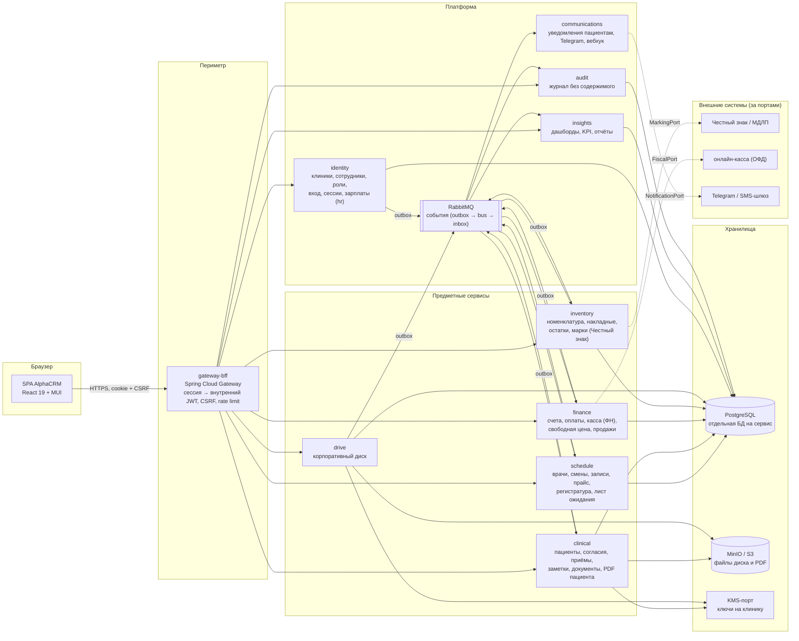
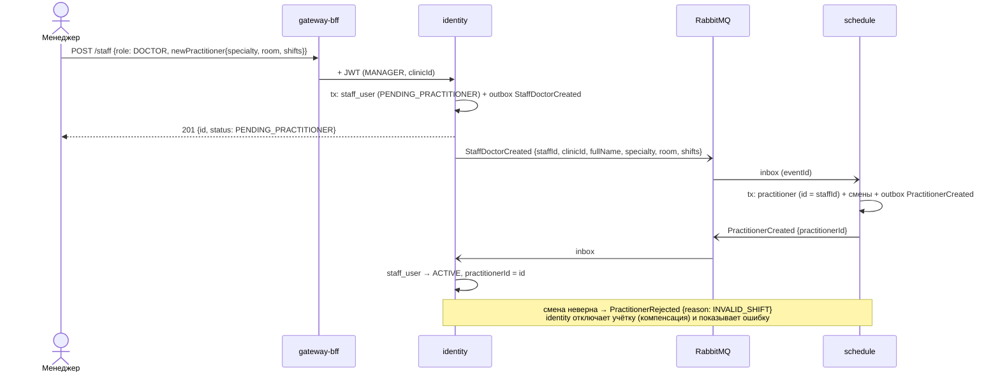
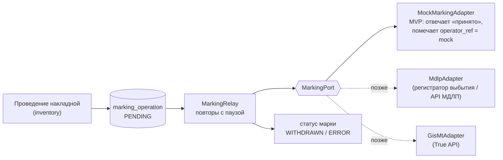
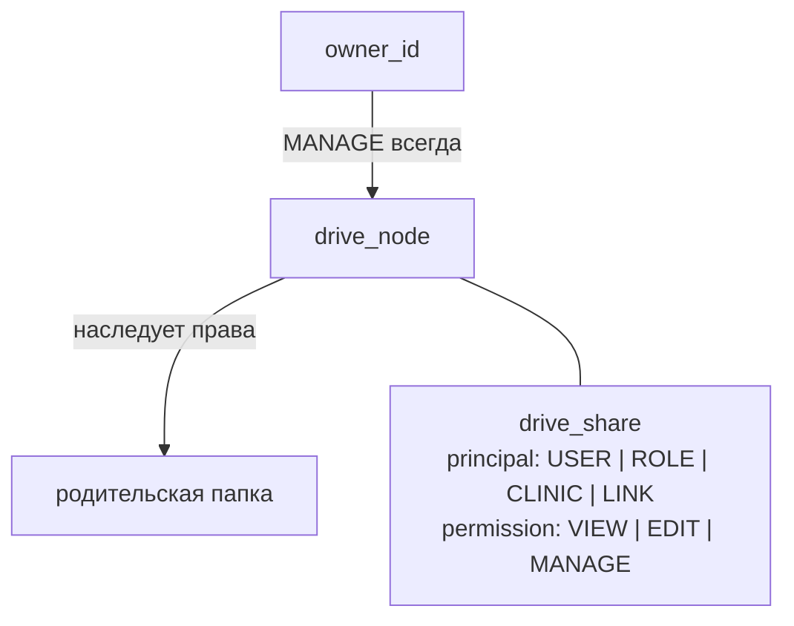
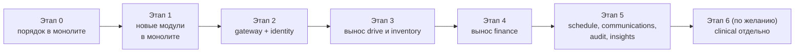

# Целевая архитектура AlphaCRM: от модульного монолита к сервисам

Проектный документ. Описывает, во что превращается текущий монолит (`ru.quietclinic`, Spring Modulith, см. [architecture.md](architecture.md) и [data-model.md](data-model.md)), как делятся данные и права и в каком порядке переезжать. Кода здесь нет; решения, которые надо подтвердить, отмечены **[Допущение]** и собраны в разделе K.

Проект не заявляет соответствие законодательству или регуляторным требованиям. Всё, что касается маркировки, хранения медицинских документов и удаления данных, требует проверки юристом и по официальной документации операторов.

## Содержание

- [A. Vision](#a-vision)
- [B. Карта сервисов](#b-карта-сервисов)
- [C. Матрица RBAC](#c-матрица-rbac)
- [D. Ключевые сценарии](#d-ключевые-сценарии)
- [E. Модель данных по сервисам](#e-модель-данных-по-сервисам)
- [F. API outline](#f-api-outline)
- [G. Честный знак: MVP и полная интеграция](#g-честный-знак-mvp-и-полная-интеграция)
- [H. Диск: ACL и хранилище](#h-диск-acl-и-хранилище)
- [I. План миграции](#i-план-миграции)
- [J. Первый двухнедельный инкремент](#j-первый-двухнедельный-инкремент)
- [K. Открытые решения и риски](#k-открытые-решения-и-риски)

---

## A. Vision

AlphaCRM остаётся одной системой для сотрудника — один вход, одно SPA, первая страница после входа — персональный дашборд. Внутри она делится на домены с отдельными владельцами данных: **расписание**, **клинический контур**, **финансы**, **склад**, **диск**, плюс общая платформа (**identity**, **gateway/BFF**, **audit**, **события**, **уведомления**, **аналитика**).

Три принципа, которые переезжают из текущего кода без изменений:

1. **Клинический текст изолирован.** Его читает только врач с активной связью с лечением (`care_relationship`), хранится он зашифрованным (AES-GCM, `KmsPort`). Финансы, склад, диск, аналитика и техподдержка его не получают ни по API, ни событиями.
2. **Права — только на сервере.** Интерфейс прячет кнопки, решение принимает сервис по разрешению (permission) и атрибутам (своя клиника, своя запись, связь с лечением).
3. **Всё в пределах клиники.** `clinicId` — в каждой строке, каждом событии и каждом токене; чужое выглядит как несуществующее (`404`).

Переезд — **без «большого взрыва»**: сначала порядок внутри монолита (разрешения, схемы на модуль, события через outbox), затем вынос сервисов по одному за gateway, начиная с наименее связанных (диск, склад). Клинический контур выносится последним или остаётся ядром монолита — это допустимый конечный вид.

Стек сохраняется: Java 21 + Spring Boot 4, React 19 + MUI, PostgreSQL 18, Docker Compose; добавляются брокер сообщений (RabbitMQ), S3-совместимое хранилище (MinIO) и gateway (Spring Cloud Gateway). Kubernetes не обязателен: одна клиника на одном VDS живёт и в Compose.

---

## B. Карта сервисов



| Сервис | Владеет данными | Из текущего кода | Не получает никогда |
|---|---|---|---|
| `gateway-bff` | ничего (только сессии в Redis/памяти) | nginx-прокси, `SecurityConfig` (CSRF, cookie) | — |
| `identity` | клиники, сотрудники, роли и разрешения, вход, сессии, сброс паролей, `hr` (договоры, ставки, зарплаты), жизненный цикл клиники (удаление) | модуль `staff`, `ClinicBootstrap`, `LoginThrottle` | клинический текст, контакты пациентов |
| `schedule` | врачи (карточки, кабинеты), смены, каталог услуг и цены, записи и статусы, задачи регистратуры, лист ожидания | `scheduling`, `registry` | клинический текст; пациент — только проекция «id + ФИО + телефон для регистратуры» |
| `clinical` | пациенты, контакты, согласия, связь с лечением, приёмы, заметки, документы, PDF пациента | `patients`, `clinical` | деньги, остатки |
| `finance` | счета, оплаты, чеки, свободные суммы, продажи товаров, агрегаты выручки | `billing`, `FiscalPort` | клинический текст; пациент — только «id + ФИО» для счёта |
| `inventory` | номенклатура, категории, склады, накладные и строки, остатки, партии, марки (SGTIN), исходящие операции маркировки | — (новый) | пациенты (в списании — только id приёма) |
| `drive` | папки, файлы, версии, права и ссылки, квоты | — (новый) | клинические PDF пациента (они в `clinical`) |
| `communications` | шаблоны, исходящие сообщения, попытки доставки | `communications` (outbox, вебхук, Telegram) | клинический текст |
| `audit` | журнал событий | `audit` | любое содержимое (только коды) |
| `insights` | read-модели: KPI по ролям, графики, отчёты и их выгрузки | `AppointmentStatsService`, страница «Сегодня» | клинический текст, персональные данные пациентов в агрегатах |

**[Допущение]** `dashboards` из задания — это `insights` (read-модель на событиях) плюс страница в SPA. Расписание отдельно от дашбордов: расписание пишет, insights только читает события.

### Связи между сервисами

- **Синхронно (REST внутри сети, внутренний JWT)** — только запросы «спросить сейчас»: проверить связь с лечением, получить цену услуги для черновика счёта. Таймаут 2 с, без каскадных цепочек длиннее одного шага.
- **Асинхронно (события)** — всё, что меняет данные другого домена: создать карточку врача в расписании, выставить счёт после приёма, списать препарат после процедуры. Публикация — **transactional outbox** в той же транзакции, что изменение (как сейчас `outbox_message`); доставка — релей в RabbitMQ; приём — **inbox** с ключом идемпотентности (`eventId`), повтор безопасен.
- **Никаких общих таблиц.** На первом этапе база физически одна, но у каждого модуля своя схема (`identity`, `schedule`, `clinical`…) и свой пользователь БД с правами только на неё.

---

## C. Матрица RBAC

### Роли

| Код | Название | Назначение |
|---|---|---|
| `OWNER` | Владелец клиники | всё + зарплаты + опасные операции клиники (удаление) |
| `SENIOR_ADMINISTRATOR` | Старший администратор | всё, что у администратора + отчёты |
| `ADMINISTRATOR` | Администратор | операционное управление клиникой, кроме зарплат |
| `MANAGER` | Менеджер | операционный контур, аналитика, заведение сотрудников и врачей |
| `DOCTOR` | Врач | свои пациенты по связи с лечением, расписание, документы, прайс только чтение |
| `NURSE` | Медицинский персонал | склад, расписание, административная карточка пациента |
| `CASHIER` | Кассир | касса и оплата, без управления |
| `SUPPORT` | Техподдержка | платформа и конфигурация, без пациентских данных |

**Решение по `CASHIER`:** оставить отдельной ролью. Это самая узкая роль с доступом к деньгам; сливать её в администратора — давать кассиру персонал, прайс и склад. Права кассы входят в администратора и выше, поэтому отдельный кассир нужен только там, где на ресепшене есть человек «только принять оплату».

### Как устроены права

- Роль — набор **разрешений** вида `<сервис>.<ресурс>.<действие>` (`finance.invoice.create`, `clinical.note.read`). Набор ролей и их разрешений зашит в `identity` (версионируется кодом, не редактируется в UI), сотруднику назначается **одна или несколько** ролей в клинике.
- Внутренний JWT от gateway несёт `staffId`, `clinicId`, `roles[]`, `practitionerId?`, `permissionsVersion`. Каждый сервис проверяет разрешение (`@RequiresPermission`) **и атрибуты**: своя клиника, своя запись (`own`), связь с лечением (`care`).
- Clinical-доступ всегда двойной: разрешение роли **и** `care_relationship` (кроме административной карточки).

**[Допущение]** «Администратору — всё» и «владельцу — всё» означает всё **операционное**. Клинический текст (заметки, диагнозы, документы приёма, PDF) остаётся только у врача со связью с лечением — как сейчас. Для владельца и старшего администратора можно позже добавить break-glass: доступ с обязательной причиной, на 1 час, с отдельной записью в журнале и уведомлением. В матрице ниже его нет.

### Матрица

Обозначения: ✅ — можно; ❌ — нельзя; **R** — только чтение; **own** — только своё (свои записи, свои подписи, своя зарплата); **care** — при активной связи с лечением; **adm** — административная карточка без клинического текста; **agg** — только агрегаты без персональных данных; **mask** — без ФИО и контактов пациентов.

| Возможность | OWNER | SENIOR_ADM | ADM | MANAGER | DOCTOR | NURSE | CASHIER | SUPPORT |
|---|---|---|---|---|---|---|---|---|
| **identity**: сотрудники — список, создание, отключение | ✅ | ✅ | ✅ | ✅ | ❌ | ❌ | ❌ | R (без зарплат) |
| identity: назначить роль `OWNER` / `SENIOR_ADMINISTRATOR` | ✅ | ❌ | ❌ | ❌ | ❌ | ❌ | ❌ | ❌ |
| identity: сбросить пароль сотруднику | ✅ | ✅ | ✅ | ✅ | ❌ | ❌ | ❌ | ✅ (кроме `OWNER`) |
| **hr**: зарплаты и ставки других | ✅ | ❌ | ❌ | ❌ | ❌ | ❌ | ❌ | ❌ |
| hr: своя зарплата | own | own | own | own | own | own | own | own |
| **schedule**: смотреть расписание | ✅ | ✅ | ✅ | ✅ | ✅ | ✅ | ✅ | mask |
| schedule: записать, перенести, отменить | ✅ | ✅ | ✅ | ✅ | own (свои записи) | ✅ | ❌ | ❌ |
| schedule: врачи, смены, кабинеты | ✅ | ✅ | ✅ | ✅ | R | R | R | R |
| **прайс**: смотреть | ✅ | ✅ | ✅ | ✅ | R | R | R | R |
| прайс: цены, свободная цена, услуги | ✅ | ✅ | ✅ | ❌ | ❌ | ❌ | ❌ | ❌ |
| **clinical**: административная карточка пациента | ✅ adm | ✅ adm | ✅ adm | ✅ adm | care | adm | adm (ФИО) | ❌ |
| clinical: регистрация и правка карточки, согласия | ✅ | ✅ | ✅ | ✅ | ❌ | ❌ | ❌ | ❌ |
| clinical: заметки, диагнозы, документы приёма | ❌ | ❌ | ❌ | ❌ | care | ❌ | ❌ | ❌ |
| clinical: архив подписанных документов | ❌ | ❌ | ❌ | R | own | ❌ | ❌ | ❌ |
| clinical: PDF пациента — загрузка и подпись | ✅ | ✅ | ✅ | ❌ | care | ❌ | ❌ | ❌ |
| clinical: PDF пациента — чтение подписанных | ✅ | ✅ | ✅ | ✅ | care / own | ❌ | ❌ | ❌ |
| **finance**: счета, приём оплаты | ✅ | ✅ | ✅ | R | ❌ | ❌ | ✅ | ❌ |
| finance: сумма свободной цены в счёте | ✅ | ✅ | ✅ | ❌ | ❌ | ❌ | ✅ (в пределах мин/макс) | ❌ |
| finance: возврат, аннулирование счёта | ✅ | ✅ | ✅ | ❌ | ❌ | ❌ | ❌ | ❌ |
| finance: выручка и продажи (графики) | ✅ | ✅ | ✅ | agg | ❌ | ❌ | ❌ | ❌ |
| **inventory**: номенклатура, категории | ✅ | ✅ | ✅ | ✅ | R | ✅ | ❌ | R |
| inventory: накладные (приход, расход, списание, перемещение) | ✅ | ✅ | ✅ | ✅ | ❌ | ✅ | ❌ | ❌ |
| inventory: остатки и марки | ✅ | ✅ | ✅ | ✅ | R | ✅ | ❌ | R (без связи с приёмами) |
| inventory: статус интеграции маркировки | ✅ | ✅ | ✅ | ✅ | ❌ | R | ❌ | ✅ |
| **drive**: свои файлы и выданные мне | ✅ | ✅ | ✅ | ✅ | ✅ | ✅ | ✅ | ✅ |
| drive: администрирование (квоты, внешние ссылки) | ✅ | ✅ | ✅ | ❌ | ❌ | ❌ | ❌ | ✅ (квоты, без чтения файлов) |
| **insights**: личный дашборд | ✅ | ✅ | ✅ | ✅ | ✅ | ✅ | ✅ | ✅ (платформенные KPI) |
| insights: аналитика клиники (посещаемость, загрузка) | ✅ | ✅ | ✅ | ✅ | own | ❌ | ❌ | agg |
| insights: создать и настроить отчёт | ✅ | ✅ | ❌ | ❌ | ❌ | ❌ | ❌ | ❌ |
| insights: читать готовые отчёты | ✅ | ✅ | ✅ (выданные) | ✅ (выданные) | ❌ | ❌ | ❌ | ❌ |
| **audit**: журнал | ✅ | ✅ | ✅ | ✅ | ❌ | ❌ | ❌ | ✅ (без объектов clinical) |
| **communications**: исходящие и ошибки доставки | ✅ | ✅ | ✅ | ❌ | ❌ | ❌ | ❌ | ✅ (без текста и адресата) |
| **платформа**: конфиги интеграций, логи без PII | ✅ | ❌ | ❌ | ❌ | ❌ | ❌ | ❌ | ✅ |
| **удалить клинику (тенант)** | ✅ (раздел H/E) | ❌ | ❌ | ❌ | ❌ | ❌ | ❌ | ❌ |

Пояснения:

- **Менеджер** — «всё операционное»: заводит сотрудников и врачей, видит аналитику и счета на чтение. Цены не меняет (это администратор): так прайс правит одна роль. **[Допущение]**, если менеджер должен править цены — поменять одну клетку.
- **Медперсонал** — безопасный минимум: административная карточка (ФИО, дата рождения, телефон, согласия, ближайшие записи), расписание и склад. Клинический текст — нет. Если медсестре нужна процедурная часть (назначения), это отдельное разрешение `clinical.order.read` с `care` — точка расширения, не MVP.
- **Техподдержка** — whitelist: статус сервисов и интеграций, конфигурация (без секретов), журнал без объектов `clinical`, ошибки доставки без текста и адресата, сброс паролей (кроме владельца), квоты диска, номенклатура и остатки. Расписание — только **mask**: время, врач, статус, без ФИО пациента. Логи сервисов не содержат PII по построению (как сейчас: в логах и `reason` — только коды).
- **Зарплаты** — модуль `hr` в `identity`, сейчас только сущность и запрет. Никто, кроме `OWNER`, не читает чужие; каждый видит свою.

RBAC проверяется тестами: в каждом сервисе одна параметризованная таблица `роль × endpoint → ожидаемый статус`, генерируется из этой матрицы (раздел J).

---

## D. Ключевые сценарии

### D1. Менеджер заводит врача — врач появляется в расписании

Сейчас это одна транзакция через порт `PractitionerCards`. Между сервисами — **сага с outbox**:



Смены проверяются **дважды**: в identity (та же чистая функция из общей библиотеки контрактов — чтобы отказать сразу) и в schedule (владелец правила). Учётная запись до подтверждения существует, но войти нельзя (`PENDING_PRACTITIONER`).

### D2. Запись пациента

1. Администратор открывает форму; SPA через BFF получает услуги (`schedule`) и пациентов (`clinical`, административная карточка).
2. `POST schedule/appointments` → проверки смены, пересечения, «не в прошлом», цена: фиксированная — снимок, свободная — пусто или предварительная оценка.
3. outbox `AppointmentBooked {appointmentId, patientId, practitionerId, startsAt, serviceId, priceMode}`.
4. `clinical` (inbox) создаёт или продлевает `care_relationship` (как `ensureCareRelationship` сейчас).
5. `communications` ставит подтверждение и напоминание; `insights` обновляет счётчики.

### D3. Приём и закрытие

1. Врач начинает приём: `POST clinical/encounters {appointmentId}`; clinical синхронно спрашивает у schedule статус и врача записи (`GET schedule/internal/appointments/{id}`), затем schedule получает команду `MarkInProgress` (событие `EncounterStarted`).
2. Врач завершает: `POST schedule/appointments/{id}/status COMPLETED` → `AppointmentCompleted {appointmentId, patientId, serviceId, priceMode, amountMinor?, procedures[]}`.
3. `finance` создаёт счёт (`PENDING` или `AWAITING_AMOUNT` для свободной цены).
4. `inventory` проводит расход по нормам услуги или процедуре (D7).

### D4. Оплата

`POST finance/invoices/{id}/payments {idempotencyKey, method}` → если сумма не задана (`AWAITING_AMOUNT`) — `409 AMOUNT_REQUIRED`; иначе платёж, чек через `FiscalPort` (outbox), событие `InvoicePaid` → insights. Повтор с тем же ключом возвращает прежний платёж.

### D5. Свободная цена

1. Администратор включает услуге режим `OPEN` с `minMinor`/`maxMinor` (раздел E, schedule).
2. При записи сумма необязательна (можно указать оценку `estimateMinor`).
3. При выставлении/оплате администратор или кассир вводит `amountMinor` в пределах; без суммы оплата невозможна.
4. В аналитике выручка идёт по фактической сумме, отдельным признаком `priceMode = OPEN`.

### D6. Приход препаратов по накладной с марками

1. Медсестра или менеджер создаёт накладную `RECEIPT` (поставщик, дата, строки: номенклатура, количество, партия, срок годности).
2. Для маркируемых позиций сканирует DataMatrix каждой упаковки — сохраняется SGTIN, статус `IN_STOCK_PENDING_ACCEPTANCE`.
3. Проведение накладной: остатки + outbox `MarkingOperationRequested {type: ACCEPTANCE, sgtins[]}`.
4. Адаптер маркировки (в MVP — mock) подтверждает → статус `IN_STOCK`.

### D7. Списание препарата при процедуре

1. `AppointmentCompleted` или явная команда врача/медсестры «использовано: позиция, количество, марки».
2. inventory: документ `CONSUMPTION` с `appointmentId` (без пациента и диагноза), уменьшает остаток, марки → `WITHDRAWAL_PENDING`.
3. outbox → `MarkingPort.withdraw(...)` (для лекарств — вывод из оборота для медицинского применения, раздел G).
4. Нехватка остатка — событие `StockShortage`, приём не блокируется; задача регистратуре.

### D8. Продажа товара пациенту (если клиника продаёт)

finance создаёт счёт с товарной строкой → резерв в inventory (`StockReserveRequested`) → оплата → `InvoicePaid` → inventory списывает резерв, маркируемый товар — продажа через кассу (`FiscalPort` передаёт код маркировки в чек). Отказ/таймаут — резерв снимается.

### D9. Персональный дашборд после входа

SPA после входа открывает `/home` → BFF вызывает `insights/me/dashboard` → набор виджетов по роли (раздел E, insights). Например, врач: приёмы за календарный месяц, ближайшие записи, неподписанные документы (только счётчики); кассир: неоплаченные счета.

### D10. Старший администратор строит отчёт

`POST insights/reports {template: REVENUE_BY_SERVICE, period, filters}` → асинхронная сборка из read-моделей → файл XLSX/PDF в drive (папка «Отчёты», права выданы читателям) → событие `ReportReady`.

### D11. Сотрудник делится файлом на диске

`POST drive/nodes/{id}/shares {principal: ROLE:DOCTOR, permission: VIEW}` → право наследуется вложенными файлами; каждое чтение — `DRIVE_FILE_READ` в audit.

### D12. Техподдержка разбирает ошибку доставки

`GET communications/outbox?status=FAILED` → видит шаблон, канал, причину, номер попытки; текста и адресата нет. Повтор отправки — `POST .../retry` (разрешение `communications.delivery.retry`).

### D13. Владелец удаляет клинику

См. E (`identity.clinic_lifecycle`) и K: запрос → повторный вход владельца + ввод названия клиники → обязательная свежая выгрузка → период ожидания 7 дней (клиника только для чтения, отмена возможна) → сага `TenantPurgeRequested` по всем сервисам → уничтожение ключей клиники в KMS (crypto-shredding) → подтверждения сервисов → минимальная запись в аудит платформы.

### D14. Новый сотрудник с ролью «Медперсонал»

identity создаёт учётку → событие `StaffCreated` → insights создаёт пустой дашборд, drive — личную папку. Доступа к clinical-тексту нет по матрице.

---

## E. Модель данных по сервисам

Поля-якоря — те, по которым связываются домены. Во **всех** таблицах — `clinic_id`. Чужие сущности хранятся только как **id** (без внешних ключей между сервисами) или как **проекция** — копия нескольких полей, обновляемая событиями.

### identity

| Сущность | Ключевые поля | Примечание |
|---|---|---|
| `clinic` | `id`, `name`, `time_zone`, `status` (`ACTIVE`, `READ_ONLY_PENDING_DELETION`, `DELETED`) | из `006-clinics` |
| `staff_user` | `id`, `clinic_id`, `username`, `password_hash`, `full_name`, `status` (`ACTIVE`, `DISABLED`, `PENDING_PRACTITIONER`), `practitioner_id?` | из `staff_user` |
| `staff_role` | `staff_id`, `role` | несколько ролей на сотрудника |
| `role_permission` | код в репозитории, не в БД | версия набора → `permissionsVersion` в JWT |
| `hr_contract` | `staff_id`, `position`, `rate_minor`, `currency`, `valid_from/to` | доступ: `OWNER` или сам сотрудник |
| `clinic_lifecycle_request` | `clinic_id`, `requested_by`, `requested_at`, `confirm_until`, `export_id`, `state` | удаление клиники |

События: `StaffCreated`, `StaffDoctorCreated`, `StaffDisabled`, `RolesChanged`, `ClinicDeletionRequested/Cancelled`, `TenantPurgeRequested`.

### schedule

| Сущность | Ключевые поля |
|---|---|
| `practitioner` | `id` (= `staff_id` врача), `clinic_id`, `full_name`, `specialty`, `room` |
| `practitioner_schedule` | `practitioner_id`, `day_of_week`, `starts_at`, `ends_at` |
| `clinic_service` | `id`, `name`, `duration_minutes`, `price_mode` (`FIXED` / `OPEN`), `price_minor?`, `min_minor?`, `max_minor?`, `currency`, `active`, `consumption_norms[]` (номенклатура и количество — для автосписания) |
| `appointment` | `id`, `patient_id`, `practitioner_id`, `service_id`, снимок `service_name`, `price_mode`, `amount_minor?`, `estimate_minor?`, `starts_at`, `ends_at`, `status` |
| `patient_ref` | `patient_id`, `display_name`, `phone` | **проекция** из clinical для регистратуры |
| `registry_task`, `waitlist_entry` | как сейчас |

Инварианты: `FIXED` → `price_minor` обязателен; `OPEN` → `price_minor` пуст, `0 ≤ min ≤ max`. События: `PractitionerCreated/Rejected`, `AppointmentBooked/Rescheduled/Cancelled/Completed/NoShow`, `ServicePriceChanged`.

### clinical

| Сущность | Ключевые поля |
|---|---|
| `patient`, `patient_contact`, `patient_consent` | как сейчас (`EMAIL`, `SECOND_PHONE`, `assigned_staff_id`) |
| `care_relationship` | `practitioner_id`, `patient_id`, `valid_from/until`, `reason` |
| `encounter`, `clinical_note`, `medical_document` | шифртексты как сейчас |
| `patient_file` | как сейчас (шифрованный PDF, подпись) |
| `appointment_ref` | `appointment_id`, `patient_id`, `practitioner_id`, `status` — проекция из schedule |

Ключи шифрования — **на клинику** (`KmsPort.dataKey(clinicId)`): это нужно для crypto-shredding при удалении клиники. События наружу — **только идентификаторы и факты**: `PatientRegistered {patientId, displayName, phone}` (для регистратуры и счёта), `PatientUpdated`, `EncounterStarted {appointmentId}`, `DocumentSigned {documentId}`. Ни одно событие не несёт заметок, диагнозов и документов.

### finance

| Сущность | Ключевые поля |
|---|---|
| `invoice` | `id`, `appointment_id?`, `patient_id`, `patient_name` (снимок), `status` (`AWAITING_AMOUNT`, `PENDING`, `PAID`, `VOIDED`, `REFUNDED`), `total_minor`, `currency` |
| `invoice_line` | `kind` (`SERVICE`, `GOODS`), `service_id?`, `item_id?`, `price_mode`, `amount_minor?`, `quantity`, `marking_codes[]?` |
| `payment` | `invoice_id`, `idempotency_key` (unique), `method`, `amount_minor`, `status`, `provider_ref?` |
| `fiscal_receipt` | `payment_id`, `status` (`QUEUED`, `SENT`, `FAILED`) |
| `sales_daily` | агрегат: день × услуга/категория × сумма × количество × `price_mode` |

События: `InvoiceIssued`, `InvoiceAmountSet`, `InvoicePaid`, `InvoiceVoided`, `RefundIssued`.

### inventory

| Сущность | Ключевые поля |
|---|---|
| `item_category` | `id`, `name`, `parent_id?`, `kind` (`DRUG`, `MEDICAL_DEVICE`, `CONSUMABLE`, `GOODS`) |
| `item` | `id`, `category_id`, `name`, `unit`, `gtin?`, `marked` (bool), `marking_system` (`NONE`, `MDLP`, `GIS_MT`), `rx_only?` |
| `warehouse` | `id`, `name` (основной склад, процедурный кабинет) |
| `stock_document` | `id`, `type` (`RECEIPT`, `CONSUMPTION`, `WRITE_OFF`, `TRANSFER`, `RETURN_TO_SUPPLIER`), `status` (`DRAFT`, `POSTED`, `CANCELLED`), `supplier?`, `appointment_id?`, `idempotency_key` |
| `stock_line` | `document_id`, `item_id`, `quantity`, `batch`, `expires_on`, `from_wh?`, `to_wh?` |
| `stock_balance` | `item_id`, `warehouse_id`, `batch`, `quantity` (материализовано проведением) |
| `marking_code` | `sgtin` (GTIN + серийный номер), `item_id`, `batch`, `status`, `document_id`, `warehouse_id` |
| `marking_operation` | outbox к оператору: `type`, `sgtins[]`, `status`, `attempts`, `operator_ref?`, `last_error` |

Правила: проведение идемпотентно по `idempotency_key`; проведённый документ не правится — только сторно новым документом; остаток не уходит в минус (кроме явного разрешения администратора для `CONSUMPTION` — с событием `StockShortage`).

### drive

`drive_node` (`id`, `clinic_id`, `parent_id`, `kind` FILE/FOLDER, `name`, `owner_id`, `deleted_at?`), `drive_version` (`node_id`, `version`, `object_key`, `size`, `sha256`, `uploaded_by`), `drive_share` (`node_id`, `principal_type` USER/ROLE/CLINIC/LINK, `principal_id`, `permission`, `expires_at?`, `link_token_hash?`), `drive_quota` (`clinic_id`, `bytes_used`, `bytes_limit`). Подробно — раздел H.

### insights

Только read-модели из событий: `kpi_daily` (клиника × дата × врач × метрика), `appointments_monthly` (врач × месяц × статус), `revenue_daily` (из finance), `report_definition`, `report_run` (`file_node_id` в drive). Персональные данные пациентов не хранит.

### audit, communications

`audit_event` как сейчас + `service` (кто записал) и `clinic_id`; принимает события `AuditRecorded` по шине. `communications` — как сейчас (`outbox_message`, шаблоны, вебхук, Telegram).

### Каталог событий (конверт)

```json
{
  "eventId": "uuid",
  "type": "AppointmentCompleted",
  "version": 1,
  "clinicId": "uuid",
  "occurredAt": "2026-10-28T09:00:00Z",
  "actorId": "uuid",
  "correlationId": "…",
  "payload": { "appointmentId": "uuid", "patientId": "uuid", "serviceId": "uuid", "priceMode": "OPEN" }
}
```

Схемы событий — в общем модуле `contracts` (JSON Schema + Java record), версия в типе; потребитель обязан игнорировать неизвестные поля.

---

## F. API outline

Снаружи — один префикс `/api/v1/` через gateway; путь определяет сервис. Внутри — `/internal/...` только для сервисов (внутренний JWT с `aud = service`). Ошибки — тот же формат `{timestamp, status, code, message, fields}`.

| Сервис | Ресурсы |
|---|---|
| identity | `POST /auth/login`, `/auth/logout`, `GET /auth/me` (роли, разрешения, клиника, пояс); `GET/POST /staff`, `POST /staff/{id}/disable`, `/activate`, `/password`, `PUT /staff/{id}/roles`; `GET /hr/contracts/me`, `GET/PUT /hr/contracts/{staffId}` (OWNER); `POST /clinic/deletion-requests`, `POST /clinic/deletion-requests/{id}/confirm`, `/cancel` |
| schedule | `GET/POST /practitioners`, `PUT /practitioners/{id}`, `PUT /practitioners/{id}/working-hours`; `GET/POST /services`, `PUT /services/{id}/pricing` (`{priceMode, priceMinor?, minMinor?, maxMinor?}`), `/activate`, `/deactivate`; `GET/POST /appointments`, `/{id}/reschedule`, `/{id}/cancel`, `/{id}/status`; `/registry/tasks`, `/registry/waitlist` |
| clinical | `GET/POST /patients`, `GET/PUT /patients/{id}`, `/patients/{id}/consents`, `/patients/{id}/files`; `/clinical/encounters`, `/clinical/encounters/{id}/note`, `/documents`, `/clinical/signed-documents`; `/patient-files/{id}/sign`, `/content`, `/inline` |
| finance | `GET/POST /invoices`, `GET /invoices/{id}`, `PUT /invoices/{id}/amount` (свободная цена), `POST /invoices/{id}/payments`, `POST /invoices/{id}/void`, `POST /payments/{id}/refunds`; `GET /finance/sales?from&to&groupBy=service|category|day` (agg) |
| inventory | `GET/POST /inventory/categories`, `GET/POST /inventory/items?category=&kind=&marked=&q=&sort=`, `GET/POST /inventory/documents`, `POST /inventory/documents/{id}/post`, `/cancel`; `GET /inventory/balances?warehouse=&category=`; `POST /inventory/marking/scan` (разбор DataMatrix), `GET /inventory/marking/operations?status=` |
| drive | `GET /drive/nodes?parent=`, `POST /drive/folders`, `POST /drive/files` (multipart или presigned upload), `GET /drive/files/{id}/content?version=`, `POST /drive/files/{id}/versions`, `GET/POST/DELETE /drive/nodes/{id}/shares`, `GET /drive/shared-with-me`, `GET /drive/links/{token}` (только после входа) |
| insights | `GET /me/dashboard`, `GET /analytics/appointments`, `GET /analytics/revenue`; `GET/POST /reports`, `GET /reports/{id}` |
| audit | `GET /audit/page?page&size&result&service` |
| communications | `GET /outbox?status=`, `POST /outbox/{id}/retry` |

Контракты фиксируются OpenAPI в каждом сервисе; между сервисами — контрактные тесты (Spring Cloud Contract или Pact): потребитель описывает ожидания, поставщик проверяет их в CI.

---

## G. Честный знак: MVP и полная интеграция

**Важно уточнить у клиники и по документации ЦРПТ:** для **лекарственных препаратов** действует система мониторинга движения лекарственных препаратов (**МДЛП**), а не True API ГИС МТ для товаров. Медицинская организация, применяющая маркированные препараты, обычно выводит их из оборота через **регистратор выбытия** (физическое устройство или облачный сервис оператора). Медицинские изделия и прочие товары — отдельные товарные группы со своими правилами. Ниже — архитектура, которая это учитывает; конкретные коды операций и схемы документов сверяются по официальной документации при реализации.

### Что хранится локально

| Данные | Где | Зачем |
|---|---|---|
| GTIN позиции, признак «маркируется», система (`MDLP` / `GIS_MT`) | `inventory.item` | знать, требовать ли сканирование |
| SGTIN (GTIN + серийный номер) каждой упаковки, партия, срок, склад | `inventory.marking_code` | остатки по маркам, вывод при применении |
| Статус марки | `marking_code.status` | `PENDING_ACCEPTANCE` → `IN_STOCK` → `RESERVED` → `WITHDRAWAL_PENDING` → `WITHDRAWN` / `WRITTEN_OFF` / `RETURNED`, плюс `ERROR` |
| Операции к оператору и ответы | `inventory.marking_operation` | очередь, повторы, разбор ошибок |
| Криптохвост кода | **не хранить**, кроме случаев, когда он нужен для чека (продажа маркированного товара) — тогда только до отправки чека | минимизация чувствительных данных |

### Операции, требующие обмена

| Событие в клинике | Операция у оператора (смысл) |
|---|---|
| Приход от поставщика | приёмка (подтверждение поступления на место деятельности) |
| Применение препарата при процедуре | вывод из оборота для медицинского применения (через регистратор выбытия для лекарств) |
| Списание (порча, истечение срока) | вывод из оборота / уничтожение по соответствующей схеме |
| Возврат поставщику | отгрузка/возврат |
| Перемещение между складами клиники | обычно внутреннее, если склады — одно место деятельности; иначе перемещение |
| Продажа маркированного товара | через ККТ: код маркировки в чеке (`FiscalPort`, finance) |

### MVP без живой интеграции



- Порт `MarkingPort` с методами по смыслу операций (`accept`, `withdrawForMedicalUse`, `writeOff`, `returnToSupplier`) и mock-адаптером — как `FiscalPort` и `NotificationPort` сейчас.
- Без настройки интеграции операции остаются `PENDING` с причиной `MARKING_NOT_CONFIGURED`, остатки и проведение работают. Экран «Маркировка» показывает очередь и ошибки (техподдержке и менеджеру).
- Сканирование DataMatrix — ввод со сканера как с клавиатуры, разбор GS1 (AI 01 — GTIN, AI 21 — серийный номер, AI 17 — срок, AI 10 — партия) в `inventory`.

### Границы ответственности

- **inventory** — остатки, марки, операции маркировки, накладные.
- **finance** — деньги и чек; для продажи маркированного товара получает от inventory коды из резерва и передаёт в `FiscalPort`.
- **clinical** — пациенты; inventory знает только `appointmentId`, без пациента и диагноза.
- Списание при приёме — через событие `AppointmentCompleted` (по нормам услуги) или явную команду со сканированием марок; inventory никогда не читает БД schedule или clinical.

---

## H. Диск: ACL и хранилище

**Решение:** клинические PDF пациента остаются в `clinical` (подпись, `care`, неизменяемость, шифрование ключом клиники). `drive` — **корпоративный диск**: регламенты, договоры, шаблоны, отчёты, сканы без привязки к пациенту. Загрузка на диск документа с данными пациента — запрещена политикой и отмечена в интерфейсе («меддокументы — в карточке пациента»); технически диск не распознаёт содержимое.

### Модель прав



- Права: `VIEW` (смотреть, скачивать), `EDIT` (новая версия, переименование, создание внутри папки), `MANAGE` (делиться, удалять в корзину, менять права). Владелец узла всегда `MANAGE`.
- Субъекты: `USER` (сотрудник), `ROLE` (все с ролью в клинике), `CLINIC` (все сотрудники клиники), `LINK` (ссылка).
- Наследование от папки к содержимому; явный доступ на вложенном узле может только **расширять**, не сужать (простая и предсказуемая модель). Эффективное право = максимум из своих, ролевых, клинических и унаследованных.
- Ссылки: по умолчанию **только для сотрудников клиники после входа**, срок жизни обязателен (до 30 дней), токен хранится хешем. Публичные ссылки без входа выключены политикой клиники; включить может `OWNER` (точка расширения).
- Корзина: удаление → `deleted_at`, 30 дней восстановления, затем удаление объекта из хранилища.
- Аудит: `DRIVE_FILE_READ`, `DRIVE_FILE_UPLOADED`, `DRIVE_SHARE_CHANGED` — с id узла, без имени файла.

### Хранилище

- Объекты — **MinIO** (S3 API) в том же Compose; ключ объекта случайный (`clinicId/uuid`), имя файла только в метаданных.
- Шифрование: envelope — ключ данных на клинику из `KmsPort`, шифрование на стороне сервиса (как PDF пациента) или SSE-KMS MinIO. Для MVP — шифрование в сервисе (переиспользуется `EncryptionService.encryptBytes`).
- Загрузка больших файлов — presigned URL после проверки прав в drive; скачивание — через drive (stream) или короткоживущий presigned URL (60 с).
- Версии: каждая загрузка поверх — новая `drive_version`, хеш SHA-256; хранится N последних (по умолчанию 20).
- Квоты на клинику; лимит файла — настраиваемый (по умолчанию 100 МБ); опционально антивирус (ClamAV) до публикации версии.

---

## I. План миграции

Стратегия — **strangler fig**: gateway маршрутизирует путь в новый сервис, когда тот готов; монолит продолжает обслуживать остальное. Каждый этап выкатывается отдельно и обратим.



| Этап | Что делаем | Что переиспользуем | Готово, когда |
|---|---|---|---|
| **0. Порядок в монолите** | разрешения вместо `requireRole`; новые роли; таблица RBAC-тестов; схема PostgreSQL на модуль (новые таблицы — сразу в своей схеме, старые переносятся changeset-ом `ALTER TABLE … SET SCHEMA` с представлением-совместимостью); общий конверт событий и inbox; ключи KMS на клинику | `PlatformConfig`, `ModularityTest`, `outbox_message` | все тесты зелёные, ни один модуль не читает чужую схему (проверка в CI по правам пользователя БД) |
| **1. Новые модули** | `inventory`, `drive`, `finance` (из `billing` + свободная цена + возвраты), `insights` (дашборд вместо «Сегодня»), `hr` (сущность + запрет), отчёты | `billing`, `FiscalPort`, `PatientFile`/`EncryptionService.encryptBytes`, `AppointmentStatsService`, `TodayPage` | функции доступны пользователям, связь модулей только событиями |
| **2. Gateway + identity** | Spring Cloud Gateway перед монолитом; сессия в gateway (Redis), внутрь — подписанный JWT (5 мин); identity выносится первым сервисом (вход, сотрудники, роли) | `staff`, `LoginThrottle`, `ActiveStaffFilter`, nginx-конфиг | монолит не хранит сессий; вход и сотрудники — в identity |
| **3. drive, inventory** | отдельные деплойменты и базы; gateway маршрутизирует `/drive/**`, `/inventory/**` | модули этапа 1 как есть | события через RabbitMQ, контрактные тесты в CI |
| **4. finance** | отдельный сервис; счёт создаётся по `AppointmentCompleted`; проекция пациента «ФИО» | `charge` → `invoice`, `payment_record` → `payment` (миграция данных скриптом с сохранением id) | касса работает без монолита |
| **5. schedule, communications, audit, insights** | вынос по одному; `PractitionerCards` → сага D1; `VisitAppointments` → внутренний REST + события | `scheduling`, `registry`, `communications`, `audit` | в монолите остаётся clinical |
| **6. clinical (по желанию)** | отдельный сервис с самой жёсткой сетью: доступ только из gateway и schedule (внутренний REST) | `patients`, `clinical` | или остаётся «ядром» — это нормальный конечный вид |

Данные при выносе: сервис получает **свою базу** (на том же сервере PostgreSQL, свой пользователь), данные переносятся скриптом в окно обслуживания или двойной записью на переходный период; id сохраняются, поэтому ссылки в событиях и аудите остаются верными. Docker-тома `quiet-clinic-*` и база `quiet_clinic` остаются для монолита.

---

## J. Первый двухнедельный инкремент

Цель: подготовить почву без выноса сервисов и дать пользователям видимую пользу.

1. **ADR** (этот документ + решения раздела K) — согласовать с владельцем.
2. **Разрешения в монолите:** `Permission` enum, карта `роль → разрешения`, аннотация/проверка `requirePermission(...)` рядом с `requireRole`; перевести 3–4 модуля. Новые коды ролей `OWNER`, `SENIOR_ADMINISTRATOR`, `NURSE`, `SUPPORT` в `staff` (миграция `CHECK` на роли), несколько ролей на сотрудника — следующим инкрементом.
3. **RBAC-тест из матрицы:** CSV `роль, метод, путь, ожидаемый статус` + параметризованный `RbacMatrixTest`; падает при расхождении матрицы и кода.
4. **Свободная цена:** `clinic_service.price_mode`, `min/max`; запись хранит `price_mode`, `amount_minor` может быть пустым; счёт `AWAITING_AMOUNT`, `PUT /charges/{id}/amount`; оплата без суммы — `409 AMOUNT_REQUIRED`; интерфейс «График и цены» и касса.
5. **Персональный дашборд v1:** `GET /me/dashboard` в монолите (модуль `insights`): врач/админ — приёмы за календарный месяц, остальные — 2–3 KPI по роли; страница «Сегодня» показывает эти виджеты сверху.
6. **Конверт событий и inbox:** таблица `domain_event_inbox`, общий формат (раздел E), первое событие `AppointmentCompleted` → создание счёта через событие внутри монолита вместо прямого вызова `ChargeService`.
7. **Документация:** обновить [architecture.md](architecture.md) и [data-model.md](data-model.md).

Не входит: RabbitMQ, gateway, вынос сервисов, склад и диск — следующий инкремент (склад: категории, номенклатура, накладная `RECEIPT`/`CONSUMPTION`, mock маркировки).

---

## K. Открытые решения и риски

| # | Вопрос | Предложение | Риск, если не решить |
|---|---|---|---|
| 1 | «Администратору/владельцу — всё» и клинический текст | текст только врачу с `care`; break-glass для `OWNER` — позже, с причиной и аудитом | утечка медданных сотрудникам без медицинского основания |
| 2 | Удаление клиники владельцем | двойное подтверждение (повторный вход + ввод названия), обязательная выгрузка, 7 дней ожидания в режиме «только чтение», затем сага удаления + уничтожение ключей клиники в KMS; минимальная запись «клиника X удалена владельцем Y в T» хранится отдельно | **медицинская документация может подлежать обязательному хранению** — удаление может быть незаконным; нужна юридическая проверка, возможно вместо удаления — архив и передача выгрузки |
| 3 | Кто ещё может удалять клинику | никто: ни `SENIOR_ADMINISTRATOR`, ни `SUPPORT`, ни администратор платформы через UI; платформа — только по письменному запросу владельца и регламенту | злоупотребление, ошибка |
| 4 | Честный знак: лекарства (МДЛП) или товары (ГИС МТ), есть ли регистратор выбытия | выяснить номенклатуру клиники; MVP — порт + mock + очередь | штрафы за непроведённый вывод из оборота; переделка адаптера |
| 5 | Диск и персональные данные | диск — корпоративный; меддокументы — только в карточке пациента; предупреждение в UI | меддокументы окажутся вне `care`-контроля |
| 6 | Зарплаты | только `OWNER` и сам сотрудник; модуль-заглушка | неожиданное расширение scope |
| 7 | Менеджер и цены | цены меняет администратор и выше | спор о правах — одна клетка матрицы |
| 8 | Несколько ролей на сотрудника | да, объединение разрешений | без этого — дубли учётных записей |
| 9 | Брокер: RabbitMQ или outbox-поллинг без брокера | старт без брокера (релей читает outbox других схем через свои API), RabbitMQ — с этапа 3 | преждевременная инфраструктура для одного VDS |
| 10 | Распределённые транзакции | только саги с компенсацией и идемпотентные потребители | «висящие» состояния (`PENDING_PRACTITIONER`) — нужен экран и таймаут |
| 11 | Операционная нагрузка (много сервисов на одном VDS) | один VDS тянет 8–10 JVM с трудом: собирать на Spring Boot с CDS/ограниченной памятью или выносить только то, что нужно; модульный монолит — допустимый конечный вид для одной клиники | рост затрат на поддержку без выгоды |
| 12 | Техподдержка и маскирование | маска на уровне API (сервис не отдаёт ФИО роли `SUPPORT`), не в UI | данные пациентов в инструментах поддержки |
